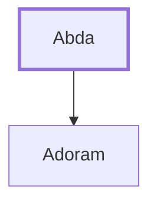

# Abda

Father of Adoram, who was over forced labor

**Original-language names:** עַבְדָּא (H5653)

## When

- **Placed around:** [[connections/timeline/11th century BC|1014 BC]] *(Ussher: the median date of the passages naming them)*

## Family

- **Children:** [[connections/people/Adoram|Adoram]]

**Family group:** [[connections/genealogy/Family of Abda|Family of Abda]], generation 1

## Appears in

[[connections/chapters/11-1-kings/1 Kings 4|1 Kings 4]]

## Appears in the same verse as

[[connections/people/Adoram|Adoram]] · [[connections/people/Ahishar|Ahishar]]
