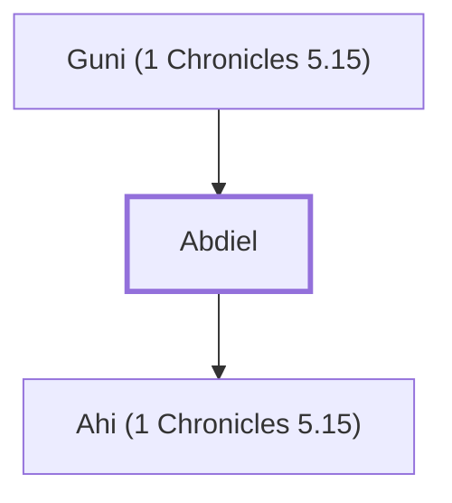

# Abdiel

A Gadite leader

**Original-language names:** עַבְדִּיאֵל (H5661)

## When

- **Placed around:** [[connections/timeline/11th century BC|1060 BC]] *(Ussher: the median date of the passages naming them)*

## Family

- **Father:** [[connections/people/Guni (1 Chronicles 5.15)|Guni (1 Chronicles 5.15)]]
- **Children:** [[connections/people/Ahi (1 Chronicles 5.15)|Ahi (1 Chronicles 5.15)]]
- **Tribe or nation:** Tribe of Gad

**Family group:** [[connections/genealogy/Family of Guni (1 Chronicles 5.15)|Family of Guni (1 Chronicles 5.15)]], generation 2

## Appears in

[[connections/chapters/13-1-chronicles/1 Chronicles 5|1 Chronicles 5]]

## Appears in the same verse as

[[connections/people/Ahi (1 Chronicles 5.15)|Ahi (1 Chronicles 5.15)]] · [[connections/people/Guni (1 Chronicles 5.15)|Guni (1 Chronicles 5.15)]]
