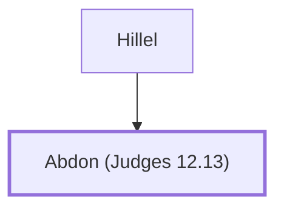

# Abdon (Judges 12.13)

A minor judge of Israel from Ephraim

**Original-language names:** עַבְדּוֹן (H5658)

## When

- **Placed around:** [[connections/timeline/12th century BC|1156 BC]] *(Ussher: the median date of the passages naming them)*

## Family

- **Father:** [[connections/people/Hillel|Hillel]]

**Family group:** [[connections/genealogy/Family of Hillel|Family of Hillel]], generation 2

## Events

- [[connections/timeline/12th century BC|1129 BC]] · [[connections/events/Judgeship of Abdon|Judgeship of Abdon]]

## Appears in

[[connections/chapters/07-judges/Judges 12|Judges 12 (2)]]

## Appears in the same verse as

[[connections/people/Hillel|Hillel (2)]] · [[connections/people/Ephraim|Ephraim]] · [[connections/people/Israel|Israel]] · [[connections/places/Pirathon|Pirathon]]
