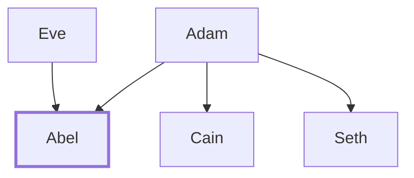

# Abel

Adam and Eve's second son, killed by Cain

**Original-language names:** הֶ֫בֶל (H1893) · Ἄβελ (G0006)

## When

- **Lived:** [[connections/timeline/40th century BC|3938 BC]] – [[connections/timeline/39th century BC|3875 BC]] *(Jones)*
- **Placed around:** [[connections/timeline/41st century BC|4003 BC]] *(Ussher: the median date of the passages naming them)*

## Family

- **Father:** [[connections/people/Adam|Adam]]
- **Mother:** [[connections/people/Eve|Eve]]
- **Brothers and sisters:** [[connections/people/Cain|Cain]], [[connections/people/Seth|Seth]]
- **Tribe or nation:** Early Patriarch

**Family group:** [[connections/genealogy/Family of Adam|Family of Adam]], generation 2

## Events

- [[connections/timeline/39th century BC|3875 BC]] · [[connections/events/Cain kills Abel|Cain kills Abel]]

## Appears in

[[connections/chapters/01-genesis/Genesis 4|Genesis 4 (5)]] · [[connections/chapters/40-matthew/Matthew 23|Matthew 23]] · [[connections/chapters/42-luke/Luke 11|Luke 11]] · [[connections/chapters/58-hebrews/Hebrews 11|Hebrews 11]] · [[connections/chapters/58-hebrews/Hebrews 12|Hebrews 12]]

## Appears in the same verse as

[[connections/people/Cain|Cain (5)]] · [[connections/people/Zechariah (2 Chronicles 24.20)|Zechariah (2 Chronicles 24.20) (2)]] · [[connections/people/Adam|Adam]] · [[connections/people/Jehoiada (2 Kings 11.4)|Jehoiada (2 Kings 11.4)]] · [[connections/people/Jesus|Jesus]] · [[connections/people/Seth|Seth]]
