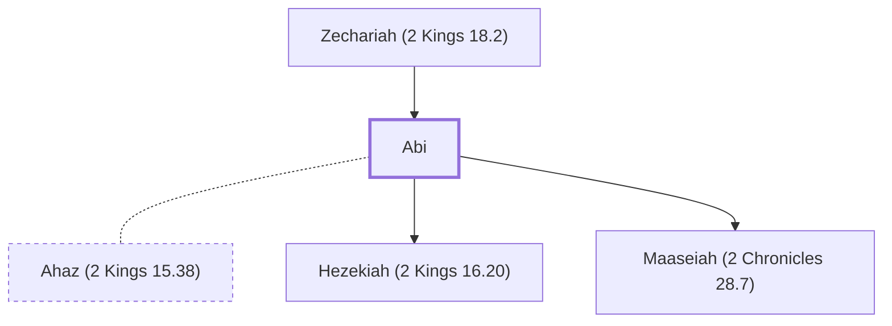

# Abi

Mother of King Hezekiah of Judah

**Also called:** Abijah

**Original-language names:** אֲבִי (H0021) · אֲבִיָּה (H0029)

## When

- **Placed around:** [[connections/timeline/8th century BC|726 BC]] *(Ussher: the median date of the passages naming them)*

## Family

- **Father:** [[connections/people/Zechariah (2 Kings 18.2)|Zechariah (2 Kings 18.2)]]
- **Spouses:** [[connections/people/Ahaz (2 Kings 15.38)|Ahaz (2 Kings 15.38)]]
- **Children:** [[connections/people/Hezekiah (2 Kings 16.20)|Hezekiah (2 Kings 16.20)]], [[connections/people/Maaseiah (2 Chronicles 28.7)|Maaseiah (2 Chronicles 28.7) (uncertain)]]

**Family group:** [[connections/genealogy/Family of Adam|Family of Adam]], generation 2

## Appears in

[[connections/chapters/12-2-kings/2 Kings 18|2 Kings 18]] · [[connections/chapters/14-2-chronicles/2 Chronicles 29|2 Chronicles 29]]

## Appears in the same verse as

[[connections/people/Zechariah (2 Kings 18.2)|Zechariah (2 Kings 18.2) (2)]] · [[connections/places/Jerusalem|Jerusalem (2)]] · [[connections/people/Hezekiah (2 Kings 16.20)|Hezekiah (2 Kings 16.20)]]
