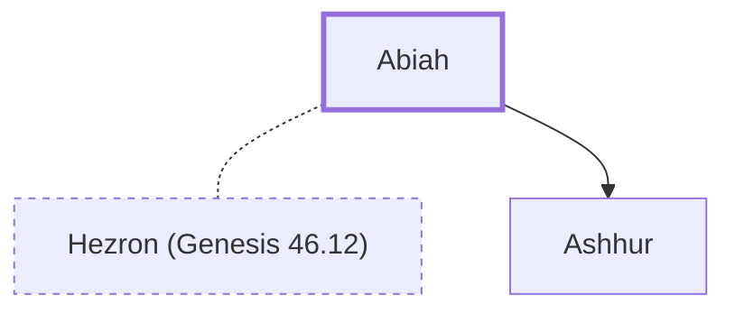

# Abiah

Wife of Hezron, who gave birth after he died

**Original-language names:** אֲבִיָּה (H0029)

## When

- **Placed around:** [[connections/timeline/15th century BC|1470 BC]] *(Ussher: the median date of the passages naming them)*

## Family

- **Spouses:** [[connections/people/Hezron (Genesis 46.12)|Hezron (Genesis 46.12)]]
- **Children:** [[connections/people/Ashhur|Ashhur]]
- **Tribe or nation:** Tribe of Judah

**Family group:** [[connections/genealogy/Family of Adam|Family of Adam]], generation 28

## Appears in

[[connections/chapters/13-1-chronicles/1 Chronicles 2|1 Chronicles 2]]

## Appears in the same verse as

[[connections/people/Ashhur|Ashhur]] · [[connections/people/Caleb (1 Chronicles 2.9)|Caleb (1 Chronicles 2.9)]] · [[connections/people/Ephrathah|Ephrathah]] · [[connections/people/Hezron (Genesis 46.12)|Hezron (Genesis 46.12)]] · [[connections/places/Caleb Ephrathah|Caleb Ephrathah]] · [[connections/places/Tekoa|Tekoa]]
