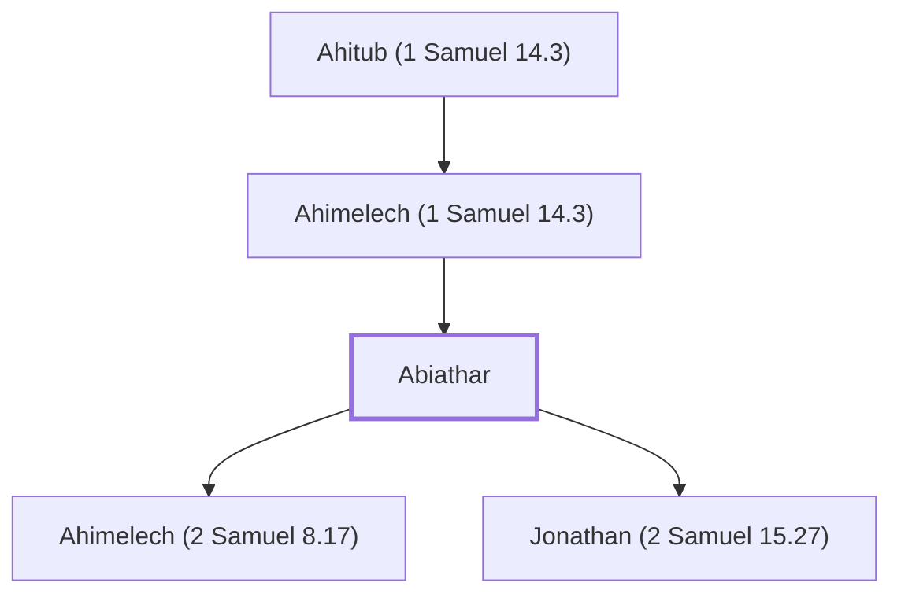

# Abiathar

High priest during the reigns of David and Solomon

**Original-language names:** אֶבְיָתָר (H0054) · Ἀβιαθάρ (G0008)

## When

- **Placed around:** [[connections/timeline/11th century BC|1021 BC]] *(Ussher: the median date of the passages naming them)*

## Family

- **Father:** [[connections/people/Ahimelech (1 Samuel 14.3)|Ahimelech (1 Samuel 14.3)]]
- **Children:** [[connections/people/Ahimelech (2 Samuel 8.17)|Ahimelech (2 Samuel 8.17)]], [[connections/people/Jonathan (2 Samuel 15.27)|Jonathan (2 Samuel 15.27)]]
- **Tribe or nation:** Tribe of Levi

**Line of descent** (5 generations, father to son): [[connections/people/Eli|Eli]] → [[connections/people/Phinehas (1 Samuel 1.3)|Phinehas (1 Samuel 1.3)]] → [[connections/people/Ahitub (1 Samuel 14.3)|Ahitub (1 Samuel 14.3)]] → [[connections/people/Ahimelech (1 Samuel 14.3)|Ahimelech (1 Samuel 14.3)]] → **Abiathar**

**Family group:** [[connections/genealogy/Family of Adam|Family of Adam]], generation 37

## Appears in

[[connections/chapters/09-1-samuel/1 Samuel 22|1 Samuel 22 (3)]] · [[connections/chapters/09-1-samuel/1 Samuel 23|1 Samuel 23 (2)]] · [[connections/chapters/09-1-samuel/1 Samuel 30|1 Samuel 30]] · [[connections/chapters/10-2-samuel/2 Samuel 8|2 Samuel 8]] · [[connections/chapters/10-2-samuel/2 Samuel 15|2 Samuel 15 (5)]] · [[connections/chapters/10-2-samuel/2 Samuel 17|2 Samuel 17]] · [[connections/chapters/10-2-samuel/2 Samuel 19|2 Samuel 19]] · [[connections/chapters/10-2-samuel/2 Samuel 20|2 Samuel 20]] · [[connections/chapters/11-1-kings/1 Kings 1|1 Kings 1 (4)]] · [[connections/chapters/11-1-kings/1 Kings 2|1 Kings 2 (4)]] · [[connections/chapters/11-1-kings/1 Kings 4|1 Kings 4]] · [[connections/chapters/13-1-chronicles/1 Chronicles 15|1 Chronicles 15]] · [[connections/chapters/13-1-chronicles/1 Chronicles 18|1 Chronicles 18]] · [[connections/chapters/13-1-chronicles/1 Chronicles 24|1 Chronicles 24]] · [[connections/chapters/13-1-chronicles/1 Chronicles 27|1 Chronicles 27]] · [[connections/chapters/41-mark/Mark 2|Mark 2]]

## Appears in the same verse as

[[connections/people/Zadok (2 Samuel 8.17)|Zadok (2 Samuel 8.17) (14)]] · [[connections/people/David|David (9)]] · [[connections/people/Adonijah (2 Samuel 3.4)|Adonijah (2 Samuel 3.4) (4)]] · [[connections/people/Joab (1 Samuel 26.6)|Joab (1 Samuel 26.6) (4)]] · [[connections/people/Ahimelech (1 Samuel 14.3)|Ahimelech (1 Samuel 14.3) (3)]] · [[connections/people/Ahimelech (2 Samuel 8.17)|Ahimelech (2 Samuel 8.17) (3)]] · [[connections/people/Jonathan (2 Samuel 15.27)|Jonathan (2 Samuel 15.27) (3)]] · [[connections/people/Saul|Saul (3)]] · [[connections/people/Seraiah (2 Samuel 8.17)|Seraiah (2 Samuel 8.17) (3)]] · [[connections/people/Solomon|Solomon (3)]] · [[connections/people/Ahimaaz (2 Samuel 15.27)|Ahimaaz (2 Samuel 15.27) (2)]] · [[connections/people/Ahithophel|Ahithophel (2)]] · [[connections/people/Ahitub (2 Samuel 8.17)|Ahitub (2 Samuel 8.17) (2)]] · [[connections/people/Benaiah (2 Samuel 8.18)|Benaiah (2 Samuel 8.18) (2)]] · [[connections/people/Israel|Israel (2)]] · [[connections/people/Jehoiada (2 Samuel 8.18)|Jehoiada (2 Samuel 8.18) (2)]] · [[connections/people/Zeruiah|Zeruiah (2)]] · [[connections/people/Abishag|Abishag]] · [[connections/people/Absalom|Absalom]] · [[connections/people/Ahitub (1 Samuel 14.3)|Ahitub (1 Samuel 14.3)]] · [[connections/people/Amminadab (1 Chronicles 15.10)|Amminadab (1 Chronicles 15.10)]] · [[connections/people/Asaiah (1 Chronicles 15.6)|Asaiah (1 Chronicles 15.6)]] · [[connections/people/Benaiah (1 Chronicles 27.34)|Benaiah (1 Chronicles 27.34)]] · [[connections/people/Doeg|Doeg]] · [[connections/people/Eleazar (Exodus 6.23)|Eleazar (Exodus 6.23)]] · [[connections/people/Eli|Eli]] · [[connections/people/Eliel (1 Chronicles 15.9)|Eliel (1 Chronicles 15.9)]] · [[connections/people/Hushai|Hushai]] · [[connections/people/Ithamar|Ithamar]] · [[connections/people/Jehoiada (1 Chronicles 27.34)|Jehoiada (1 Chronicles 27.34)]] · [[connections/people/Joel (1 Chronicles 15.7)|Joel (1 Chronicles 15.7)]] · [[connections/people/Judah (Genesis 29.35)|Judah (Genesis 29.35)]] · [[connections/people/Nethanel (1 Chronicles 24.6)|Nethanel (1 Chronicles 24.6)]] · [[connections/people/Shemaiah (1 Chronicles 15.8)|Shemaiah (1 Chronicles 15.8)]] · [[connections/people/Shemaiah (1 Chronicles 24.6)|Shemaiah (1 Chronicles 24.6)]] · [[connections/people/Uriel (1 Chronicles 15.5)|Uriel (1 Chronicles 15.5)]] · [[connections/places/Anathoth|Anathoth]] · [[connections/places/Jerusalem|Jerusalem]] · [[connections/places/Keilah|Keilah]] · [[connections/places/Shiloh|Shiloh]]
