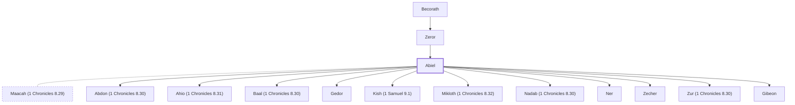

# Abiel

Father of Kish and grandfather of King Saul

**Also called:** Jeiel, Jeuel, Ner, Abigibeon

**Original-language names:** אֲבִיאֵל (H0022) · יְעִיאֵל (H3273) · יְעוּאֵל (H3262) · נֵר (H5369) · גִבְעוֹן+H0001I«H0001=אֲבִי (H1391)

## When

- **Placed around:** [[connections/timeline/11th century BC|1095 BC]] *(Ussher: the median date of the passages naming them)*

## Family

- **Father:** [[connections/people/Zeror|Zeror]]
- **Spouses:** [[connections/people/Maacah (1 Chronicles 8.29)|Maacah (1 Chronicles 8.29)]]
- **Children:** [[connections/people/Abdon (1 Chronicles 8.30)|Abdon (1 Chronicles 8.30)]], [[connections/people/Ahio (1 Chronicles 8.31)|Ahio (1 Chronicles 8.31)]], [[connections/people/Baal (1 Chronicles 8.30)|Baal (1 Chronicles 8.30)]], [[connections/people/Gedor|Gedor]], [[connections/people/Kish (1 Samuel 9.1)|Kish (1 Samuel 9.1)]], [[connections/people/Mikloth (1 Chronicles 8.32)|Mikloth (1 Chronicles 8.32)]], [[connections/people/Nadab (1 Chronicles 8.30)|Nadab (1 Chronicles 8.30)]], [[connections/people/Ner|Ner]], [[connections/people/Zecher|Zecher]], [[connections/people/Zur (1 Chronicles 8.30)|Zur (1 Chronicles 8.30)]], [[connections/places/Gibeon|Gibeon (founder)]]
- **Tribe or nation:** Tribe of Benjamin

**Line of descent** (4 generations, father to son): [[connections/people/Aphiah|Aphiah]] → [[connections/people/Becorath|Becorath]] → [[connections/people/Zeror|Zeror]] → **Abiel**

**Family group:** [[connections/genealogy/Family of Aphiah|Family of Aphiah]], generation 4

## Appears in

[[connections/chapters/09-1-samuel/1 Samuel 9|1 Samuel 9]] · [[connections/chapters/09-1-samuel/1 Samuel 14|1 Samuel 14]] · [[connections/chapters/13-1-chronicles/1 Chronicles 8|1 Chronicles 8 (2)]] · [[connections/chapters/13-1-chronicles/1 Chronicles 9|1 Chronicles 9 (2)]]

## Appears in the same verse as

[[connections/people/Kish (1 Samuel 9.1)|Kish (1 Samuel 9.1) (4)]] · [[connections/people/Saul|Saul (3)]] · [[connections/people/Abinadab (1 Samuel 14.49)|Abinadab (1 Samuel 14.49) (2)]] · [[connections/people/Ish-bosheth|Ish-bosheth (2)]] · [[connections/people/Jonathan (1 Samuel 13.2)|Jonathan (1 Samuel 13.2) (2)]] · [[connections/people/Maacah (1 Chronicles 8.29)|Maacah (1 Chronicles 8.29) (2)]] · [[connections/people/Malchi-shua|Malchi-shua (2)]] · [[connections/places/Gibeon|Gibeon (2)]] · [[connections/people/Abner|Abner]] · [[connections/people/Aphiah|Aphiah]] · [[connections/people/Becorath|Becorath]] · [[connections/people/Benjamin (Genesis 35.18)|Benjamin (Genesis 35.18)]] · [[connections/people/Ner|Ner]] · [[connections/people/Zeror|Zeror]]
