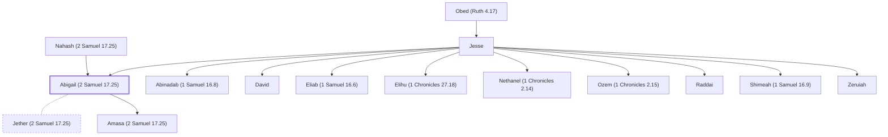

# Abigail (2 Samuel 17.25)

Sister of David; mother of Amasa

**Original-language names:** אֲבִיגַ֫יִל (H0026) · אֲבִיגַ֫ל (H0026)

## When

- **Placed around:** [[connections/timeline/18th century BC|1752 BC]] *(Ussher: the median date of the passages naming them)*

## Family

- **Father:** [[connections/people/Jesse|Jesse (uncertain)]]
- **Mother:** [[connections/people/Nahash (2 Samuel 17.25)|Nahash (2 Samuel 17.25) (uncertain)]]
- **Brothers and sisters:** [[connections/people/Abinadab (1 Samuel 16.8)|Abinadab (1 Samuel 16.8) (uncertain)]], [[connections/people/David|David (uncertain)]], [[connections/people/Eliab (1 Samuel 16.6)|Eliab (1 Samuel 16.6) (uncertain)]], [[connections/people/Elihu (1 Chronicles 27.18)|Elihu (1 Chronicles 27.18) (uncertain)]], [[connections/people/Nethanel (1 Chronicles 2.14)|Nethanel (1 Chronicles 2.14) (uncertain)]], [[connections/people/Ozem (1 Chronicles 2.15)|Ozem (1 Chronicles 2.15) (uncertain)]], [[connections/people/Raddai|Raddai (uncertain)]], [[connections/people/Shimeah (1 Samuel 16.9)|Shimeah (1 Samuel 16.9) (uncertain)]], [[connections/people/Zeruiah|Zeruiah (uncertain)]]
- **Spouses:** [[connections/people/Jether (2 Samuel 17.25)|Jether (2 Samuel 17.25)]]
- **Children:** [[connections/people/Amasa (2 Samuel 17.25)|Amasa (2 Samuel 17.25)]]
- **Tribe or nation:** Tribe of Judah

**Line of descent** (34 generations, father to son): [[connections/people/Adam|Adam]] → [[connections/people/Seth|Seth]] → [[connections/people/Enosh|Enosh]] → [[connections/people/Kenan|Kenan]] → [[connections/people/Mahalalel (Genesis 5.12)|Mahalalel (Genesis 5.12)]] → [[connections/people/Jared|Jared]] → [[connections/people/Enoch (Genesis 5.18)|Enoch (Genesis 5.18)]] → [[connections/people/Methuselah|Methuselah]] → [[connections/people/Lamech (Genesis 5.25)|Lamech (Genesis 5.25)]] → [[connections/people/Noah (Genesis 5.29)|Noah (Genesis 5.29)]] → [[connections/people/Shem|Shem]] → [[connections/people/Arpachshad|Arpachshad]] → [[connections/people/Cainan|Cainan]] → [[connections/people/Shelah (Genesis 10.24)|Shelah (Genesis 10.24)]] → [[connections/people/Eber (Genesis 10.21)|Eber (Genesis 10.21)]] → [[connections/people/Peleg|Peleg]] → [[connections/people/Reu|Reu]] → [[connections/people/Serug|Serug]] → [[connections/people/Nahor (Genesis 11.22)|Nahor (Genesis 11.22)]] → [[connections/people/Terah|Terah]] → [[connections/people/Abraham|Abraham]] → [[connections/people/Isaac|Isaac]] → [[connections/people/Israel|Israel]] → [[connections/people/Judah (Genesis 29.35)|Judah (Genesis 29.35)]] → [[connections/people/Perez|Perez]] → [[connections/people/Hezron (Genesis 46.12)|Hezron (Genesis 46.12)]] → [[connections/people/Ram (Ruth 4.19)|Ram (Ruth 4.19)]] → [[connections/people/Amminadab (Exodus 6.23)|Amminadab (Exodus 6.23)]] → [[connections/people/Nahshon|Nahshon]] → [[connections/people/Salmon|Salmon]] → [[connections/people/Boaz|Boaz]] → [[connections/people/Obed (Ruth 4.17)|Obed (Ruth 4.17)]] → [[connections/people/Jesse|Jesse]] → **Abigail (2 Samuel 17.25)**

**Family group:** [[connections/genealogy/Family of Adam|Family of Adam]], generation 34

## Appears in

[[connections/chapters/10-2-samuel/2 Samuel 17|2 Samuel 17]] · [[connections/chapters/13-1-chronicles/1 Chronicles 2|1 Chronicles 2 (2)]]

## Appears in the same verse as

[[connections/people/Amasa (2 Samuel 17.25)|Amasa (2 Samuel 17.25) (2)]] · [[connections/people/Jether (2 Samuel 17.25)|Jether (2 Samuel 17.25) (2)]] · [[connections/people/Joab (1 Samuel 26.6)|Joab (1 Samuel 26.6) (2)]] · [[connections/people/Zeruiah|Zeruiah (2)]] · [[connections/people/Abishai|Abishai]] · [[connections/people/Absalom|Absalom]] · [[connections/people/Asahel (2 Samuel 2.18)|Asahel (2 Samuel 2.18)]] · [[connections/people/Nahash (2 Samuel 17.25)|Nahash (2 Samuel 17.25)]]
