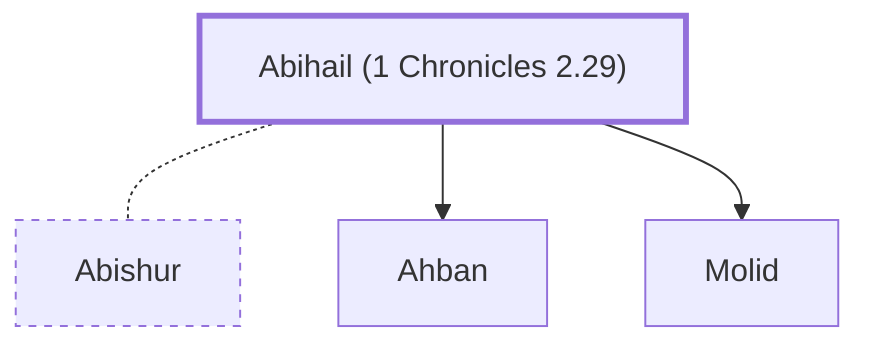

# Abihail (1 Chronicles 2.29)

Wife of Abishur; mother of Ahban and Molid

**Original-language names:** אֲבִיחַ֫יִל (H0032)

## When

- **Placed around:** [[connections/timeline/15th century BC|1470 BC]] *(Ussher: the median date of the passages naming them)*

## Family

- **Spouses:** [[connections/people/Abishur|Abishur]]
- **Children:** [[connections/people/Ahban|Ahban]], [[connections/people/Molid|Molid]]
- **Tribe or nation:** Tribe of Judah(?)

**Family group:** [[connections/genealogy/Family of Adam|Family of Adam]], generation 32

## Appears in

[[connections/chapters/13-1-chronicles/1 Chronicles 2|1 Chronicles 2]]

## Appears in the same verse as

[[connections/people/Abishur|Abishur]] · [[connections/people/Ahban|Ahban]] · [[connections/people/Molid|Molid]]
