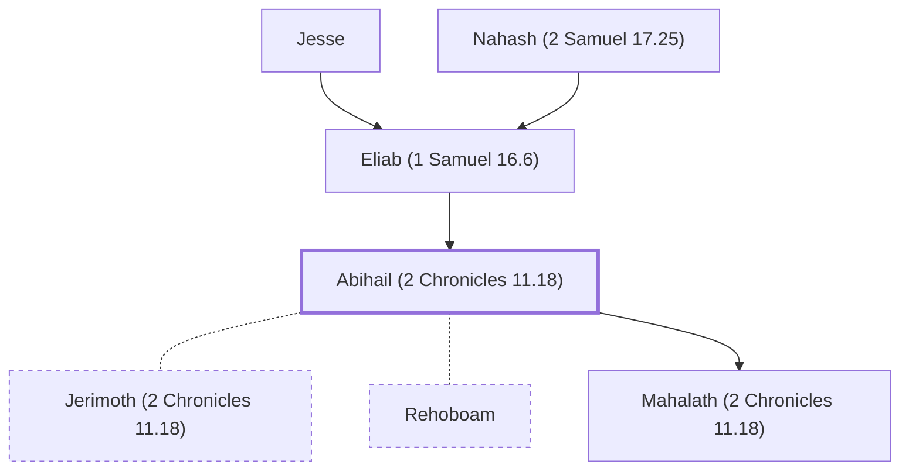

# Abihail (2 Chronicles 11.18)

Mother of Rehoboam's wife Mahalath

**Original-language names:** אֲבִיחַ֫יִל (H0032)

## When

- **Placed around:** [[connections/timeline/10th century BC|975 BC]] *(Ussher: the median date of the passages naming them)*

## Family

- **Father:** [[connections/people/Eliab (1 Samuel 16.6)|Eliab (1 Samuel 16.6)]]
- **Spouses:** [[connections/people/Jerimoth (2 Chronicles 11.18)|Jerimoth (2 Chronicles 11.18)]], [[connections/people/Rehoboam|Rehoboam]]
- **Children:** [[connections/people/Mahalath (2 Chronicles 11.18)|Mahalath (2 Chronicles 11.18)]]
- **Tribe or nation:** Tribe of Judah

**Line of descent** (35 generations, father to son): [[connections/people/Adam|Adam]] → [[connections/people/Seth|Seth]] → [[connections/people/Enosh|Enosh]] → [[connections/people/Kenan|Kenan]] → [[connections/people/Mahalalel (Genesis 5.12)|Mahalalel (Genesis 5.12)]] → [[connections/people/Jared|Jared]] → [[connections/people/Enoch (Genesis 5.18)|Enoch (Genesis 5.18)]] → [[connections/people/Methuselah|Methuselah]] → [[connections/people/Lamech (Genesis 5.25)|Lamech (Genesis 5.25)]] → [[connections/people/Noah (Genesis 5.29)|Noah (Genesis 5.29)]] → [[connections/people/Shem|Shem]] → [[connections/people/Arpachshad|Arpachshad]] → [[connections/people/Cainan|Cainan]] → [[connections/people/Shelah (Genesis 10.24)|Shelah (Genesis 10.24)]] → [[connections/people/Eber (Genesis 10.21)|Eber (Genesis 10.21)]] → [[connections/people/Peleg|Peleg]] → [[connections/people/Reu|Reu]] → [[connections/people/Serug|Serug]] → [[connections/people/Nahor (Genesis 11.22)|Nahor (Genesis 11.22)]] → [[connections/people/Terah|Terah]] → [[connections/people/Abraham|Abraham]] → [[connections/people/Isaac|Isaac]] → [[connections/people/Israel|Israel]] → [[connections/people/Judah (Genesis 29.35)|Judah (Genesis 29.35)]] → [[connections/people/Perez|Perez]] → [[connections/people/Hezron (Genesis 46.12)|Hezron (Genesis 46.12)]] → [[connections/people/Ram (Ruth 4.19)|Ram (Ruth 4.19)]] → [[connections/people/Amminadab (Exodus 6.23)|Amminadab (Exodus 6.23)]] → [[connections/people/Nahshon|Nahshon]] → [[connections/people/Salmon|Salmon]] → [[connections/people/Boaz|Boaz]] → [[connections/people/Obed (Ruth 4.17)|Obed (Ruth 4.17)]] → [[connections/people/Jesse|Jesse]] → [[connections/people/Eliab (1 Samuel 16.6)|Eliab (1 Samuel 16.6)]] → **Abihail (2 Chronicles 11.18)**

**Family group:** [[connections/genealogy/Family of Adam|Family of Adam]], generation 35

## Appears in

[[connections/chapters/14-2-chronicles/2 Chronicles 11|2 Chronicles 11]]

## Appears in the same verse as

[[connections/people/David|David]] · [[connections/people/Eliab (1 Samuel 16.6)|Eliab (1 Samuel 16.6)]] · [[connections/people/Jerimoth (2 Chronicles 11.18)|Jerimoth (2 Chronicles 11.18)]] · [[connections/people/Jesse|Jesse]] · [[connections/people/Mahalath (2 Chronicles 11.18)|Mahalath (2 Chronicles 11.18)]] · [[connections/people/Rehoboam|Rehoboam]]
