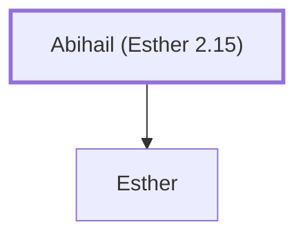

# Abihail (Esther 2.15)

Father of Esther (Hadassah)

**Original-language names:** אֲבִיחַ֫יִל (H0032)

## When

- **Placed around:** [[connections/timeline/5th century BC|452 BC]] *(Ussher: the median date of the passages naming them)*

## Family

- **Children:** [[connections/people/Esther|Esther]]

**Family group:** [[connections/genealogy/Family of Abihail (Esther 2.15)|Family of Abihail (Esther 2.15)]], generation 1

## Appears in

[[connections/chapters/17-esther/Esther 2|Esther 2]] · [[connections/chapters/17-esther/Esther 9|Esther 9]]

## Appears in the same verse as

[[connections/people/Esther|Esther (2)]] · [[connections/people/Mordecai (Esther 2.5)|Mordecai (Esther 2.5) (2)]] · [[connections/people/Hegai|Hegai]]
