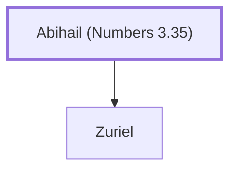

# Abihail (Numbers 3.35)

Father of Zuriel, a Levite leader

**Original-language names:** אֲבִיחַ֫יִל (H0032)

## When

- **Placed around:** [[connections/timeline/15th century BC|1490 BC]] *(Ussher: the median date of the passages naming them)*

## Family

- **Children:** [[connections/people/Zuriel|Zuriel]]

**Family group:** [[connections/genealogy/Family of Abihail (Numbers 3.35)|Family of Abihail (Numbers 3.35)]], generation 1

## Appears in

[[connections/chapters/04-numbers/Numbers 3|Numbers 3]]

## Appears in the same verse as

[[connections/people/Zuriel|Zuriel]]
