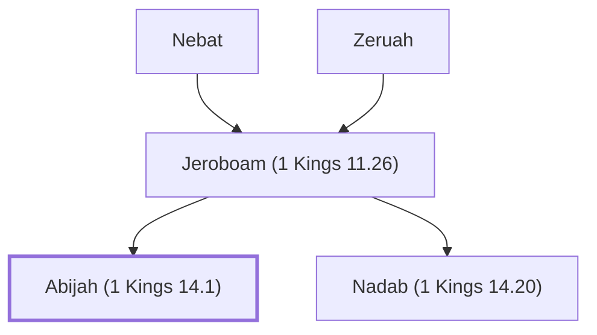

# Abijah (1 Kings 14.1)

Son of Jeroboam I, died in childhood

**Original-language names:** אֲבִיָּה (H0029)

## Family

- **Father:** [[connections/people/Jeroboam (1 Kings 11.26)|Jeroboam (1 Kings 11.26)]]
- **Brothers and sisters:** [[connections/people/Nadab (1 Kings 14.20)|Nadab (1 Kings 14.20)]]
- **Tribe or nation:** Israel

**Line of descent** (3 generations, father to son): [[connections/people/Nebat|Nebat]] → [[connections/people/Jeroboam (1 Kings 11.26)|Jeroboam (1 Kings 11.26)]] → **Abijah (1 Kings 14.1)**

**Family group:** [[connections/genealogy/Family of Nebat|Family of Nebat]], generation 3

## Appears in

[[connections/chapters/11-1-kings/1 Kings 14|1 Kings 14]]

## Appears in the same verse as

[[connections/people/Jeroboam (1 Kings 11.26)|Jeroboam (1 Kings 11.26)]]
