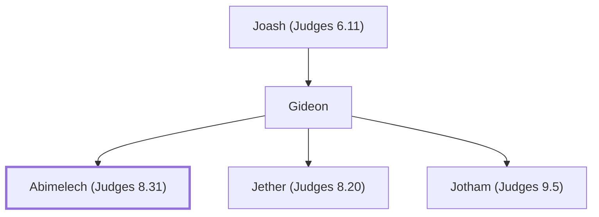

# Abimelech (Judges 8.31)

Son of Gideon, self-proclaimed king of Shechem

**Original-language names:** אֲבִימֶ֫לֶךְ (H0040)

## When

- **Placed around:** [[connections/timeline/13th century BC|1233 BC]] *(Ussher: the median date of the passages naming them)*

## Family

- **Father:** [[connections/people/Gideon|Gideon]]
- **Brothers and sisters:** [[connections/people/Jether (Judges 8.20)|Jether (Judges 8.20)]], [[connections/people/Jotham (Judges 9.5)|Jotham (Judges 9.5)]]

**Line of descent** (3 generations, father to son): [[connections/people/Joash (Judges 6.11)|Joash (Judges 6.11)]] → [[connections/people/Gideon|Gideon]] → **Abimelech (Judges 8.31)**

**Family group:** [[connections/genealogy/Family of Joash (Judges 6.11)|Family of Joash (Judges 6.11)]], generation 3

## Events

- [[connections/timeline/13th century BC|1218 BC]] · [[connections/events/Usurpation by Abimelech|Usurpation by Abimelech]]

## Appears in

[[connections/chapters/07-judges/Judges 8|Judges 8]] · [[connections/chapters/07-judges/Judges 9|Judges 9 (34)]] · [[connections/chapters/07-judges/Judges 10|Judges 10]] · [[connections/chapters/10-2-samuel/2 Samuel 11|2 Samuel 11]]

## Appears in the same verse as

[[connections/places/Shechem|Shechem (16)]] · [[connections/people/Gideon|Gideon (6)]] · [[connections/people/Gaal|Gaal (5)]] · [[connections/people/Ebed (Judges 9.26)|Ebed (Judges 9.26) (3)]] · [[connections/people/Israel|Israel (3)]] · [[connections/people/Zebul|Zebul (3)]] · [[connections/places/Beth-millo|Beth-millo (2)]] · [[connections/places/Thebez|Thebez (2)]] · [[connections/people/Dodo (Judges 10.1)|Dodo (Judges 10.1)]] · [[connections/people/Ephraim|Ephraim]] · [[connections/people/Hamor|Hamor]] · [[connections/people/Issachar (Genesis 30.18)|Issachar (Genesis 30.18)]] · [[connections/people/Jotham (Judges 9.5)|Jotham (Judges 9.5)]] · [[connections/people/Puah (Judges 10.1)|Puah (Judges 10.1)]] · [[connections/people/Tola (Judges 10.1)|Tola (Judges 10.1)]] · [[connections/people/Uriah (2 Samuel 11.3)|Uriah (2 Samuel 11.3)]] · [[connections/places/Arumah|Arumah]] · [[connections/places/Beeroth|Beeroth]] · [[connections/places/Ebal Mount|Ebal Mount]] · [[connections/places/Shamir (Judges 10.1)|Shamir (Judges 10.1)]]
