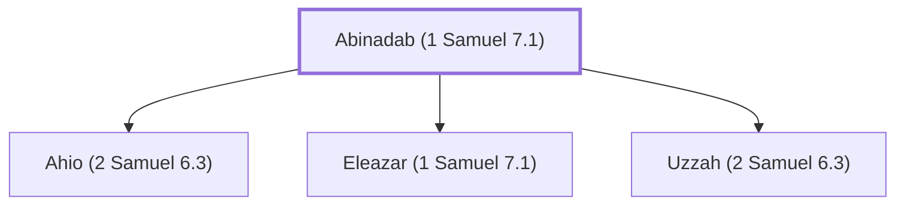

# Abinadab (1 Samuel 7.1)

Kept the ark of God in his house

**Original-language names:** אֲבִינָדָב (H0041)

## When

- **Placed around:** [[connections/timeline/11th century BC|1042 BC]] *(Ussher: the median date of the passages naming them)*

## Family

- **Children:** [[connections/people/Ahio (2 Samuel 6.3)|Ahio (2 Samuel 6.3)]], [[connections/people/Eleazar (1 Samuel 7.1)|Eleazar (1 Samuel 7.1)]], [[connections/people/Uzzah (2 Samuel 6.3)|Uzzah (2 Samuel 6.3)]]

**Family group:** [[connections/genealogy/Family of Abinadab (1 Samuel 7.1)|Family of Abinadab (1 Samuel 7.1)]], generation 1

## Appears in

[[connections/chapters/09-1-samuel/1 Samuel 7|1 Samuel 7]] · [[connections/chapters/10-2-samuel/2 Samuel 6|2 Samuel 6 (2)]] · [[connections/chapters/13-1-chronicles/1 Chronicles 13|1 Chronicles 13]]

## Appears in the same verse as

[[connections/people/Ahio (2 Samuel 6.3)|Ahio (2 Samuel 6.3) (3)]] · [[connections/people/Uzzah (2 Samuel 6.3)|Uzzah (2 Samuel 6.3) (2)]] · [[connections/people/Eleazar (1 Samuel 7.1)|Eleazar (1 Samuel 7.1)]] · [[connections/places/Kiriath-jearim|Kiriath-jearim]]
