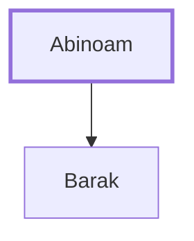

# Abinoam

Father of Barak, the Israelite commander

**Original-language names:** אֲבִינֹ֫עַם (H0042)

## When

- **Placed around:** [[connections/timeline/13th century BC|1285 BC]] *(Ussher: the median date of the passages naming them)*

## Family

- **Children:** [[connections/people/Barak|Barak]]

**Family group:** [[connections/genealogy/Family of Abinoam|Family of Abinoam]], generation 1

## Appears in

[[connections/chapters/07-judges/Judges 4|Judges 4 (2)]] · [[connections/chapters/07-judges/Judges 5|Judges 5 (2)]]

## Appears in the same verse as

[[connections/people/Barak|Barak (4)]] · [[connections/people/Deborah (Judges 4.4)|Deborah (Judges 4.4) (2)]] · [[connections/places/Tabor Mount|Tabor Mount (2)]] · [[connections/people/Israel|Israel]] · [[connections/people/Naphtali|Naphtali]] · [[connections/people/Sisera (Judges 4.2)|Sisera (Judges 4.2)]] · [[connections/people/Zebulun|Zebulun]] · [[connections/places/Kedesh|Kedesh]]
