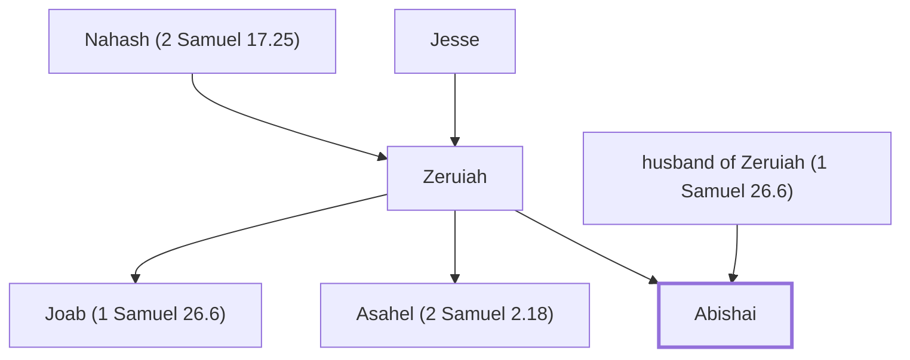

# Abishai

David's nephew, one of his mighty men and commanders

**Original-language names:** אֲבִישַׁי (H0052)

## When

- **Placed around:** [[connections/timeline/11th century BC|1037 BC]] *(Ussher: the median date of the passages naming them)*

## Family

- **Father:** [[connections/people/husband of Zeruiah (1 Samuel 26.6)|husband of Zeruiah (1 Samuel 26.6)]]
- **Mother:** [[connections/people/Zeruiah|Zeruiah]]
- **Brothers and sisters:** [[connections/people/Asahel (2 Samuel 2.18)|Asahel (2 Samuel 2.18)]], [[connections/people/Joab (1 Samuel 26.6)|Joab (1 Samuel 26.6)]]
- **Tribe or nation:** Tribe of Judah

**Family group:** [[connections/genealogy/Family of Adam|Family of Adam]], generation 37

## Appears in

[[connections/chapters/09-1-samuel/1 Samuel 26|1 Samuel 26 (4)]] · [[connections/chapters/10-2-samuel/2 Samuel 2|2 Samuel 2 (2)]] · [[connections/chapters/10-2-samuel/2 Samuel 3|2 Samuel 3]] · [[connections/chapters/10-2-samuel/2 Samuel 10|2 Samuel 10 (2)]] · [[connections/chapters/10-2-samuel/2 Samuel 16|2 Samuel 16 (2)]] · [[connections/chapters/10-2-samuel/2 Samuel 18|2 Samuel 18 (3)]] · [[connections/chapters/10-2-samuel/2 Samuel 19|2 Samuel 19]] · [[connections/chapters/10-2-samuel/2 Samuel 20|2 Samuel 20 (2)]] · [[connections/chapters/10-2-samuel/2 Samuel 21|2 Samuel 21]] · [[connections/chapters/10-2-samuel/2 Samuel 23|2 Samuel 23]] · [[connections/chapters/13-1-chronicles/1 Chronicles 2|1 Chronicles 2]] · [[connections/chapters/13-1-chronicles/1 Chronicles 11|1 Chronicles 11]] · [[connections/chapters/13-1-chronicles/1 Chronicles 18|1 Chronicles 18]] · [[connections/chapters/13-1-chronicles/1 Chronicles 19|1 Chronicles 19 (2)]]

## Appears in the same verse as

[[connections/people/Joab (1 Samuel 26.6)|Joab (1 Samuel 26.6) (13)]] · [[connections/people/Zeruiah|Zeruiah (9)]] · [[connections/people/David|David (8)]] · [[connections/places/Ammon|Ammon (4)]] · [[connections/people/Abner|Abner (3)]] · [[connections/people/Absalom|Absalom (3)]] · [[connections/people/Asahel (2 Samuel 2.18)|Asahel (2 Samuel 2.18) (3)]] · [[connections/people/Ittai (2 Samuel 15.19)|Ittai (2 Samuel 15.19) (3)]] · [[connections/people/Bichri|Bichri (2)]] · [[connections/people/Saul|Saul (2)]] · [[connections/people/Sheba (2 Samuel 20.1)|Sheba (2 Samuel 20.1) (2)]] · [[connections/places/Gibeon|Gibeon (2)]] · [[connections/places/Jerusalem|Jerusalem (2)]] · [[connections/places/Syria|Syria (2)]] · [[connections/people/Abigail (2 Samuel 17.25)|Abigail (2 Samuel 17.25)]] · [[connections/people/Ahimelech (1 Samuel 26.6)|Ahimelech (1 Samuel 26.6)]] · [[connections/people/Amasa (2 Samuel 17.25)|Amasa (2 Samuel 17.25)]] · [[connections/people/Israel|Israel]] · [[connections/people/Shimei (2 Samuel 16.5)|Shimei (2 Samuel 16.5)]] · [[connections/places/Ammah|Ammah]] · [[connections/places/Edom|Edom]] · [[connections/places/Giah|Giah]] · [[connections/places/Salt Valley|Salt Valley]]
