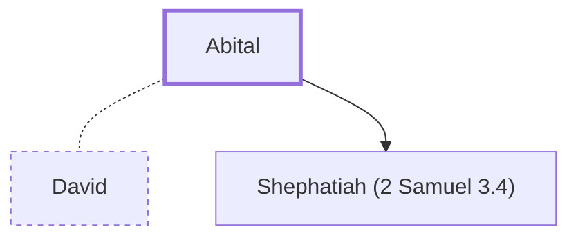

# Abital

One of David's wives; mother of Shephatiah

**Original-language names:** אֲבִיטָ֑ל (H0037)

## When

- **Placed around:** [[connections/timeline/11th century BC|1048 BC]] *(Ussher: the median date of the passages naming them)*

## Family

- **Spouses:** [[connections/people/David|David]]
- **Children:** [[connections/people/Shephatiah (2 Samuel 3.4)|Shephatiah (2 Samuel 3.4)]]

**Family group:** [[connections/genealogy/Family of Adam|Family of Adam]], generation 36

## Appears in

[[connections/chapters/10-2-samuel/2 Samuel 3|2 Samuel 3]] · [[connections/chapters/13-1-chronicles/1 Chronicles 3|1 Chronicles 3]]

## Appears in the same verse as

[[connections/people/Shephatiah (2 Samuel 3.4)|Shephatiah (2 Samuel 3.4) (2)]] · [[connections/people/Adonijah (2 Samuel 3.4)|Adonijah (2 Samuel 3.4)]] · [[connections/people/Eglah|Eglah]] · [[connections/people/Haggith|Haggith]] · [[connections/people/Ithream|Ithream]]
