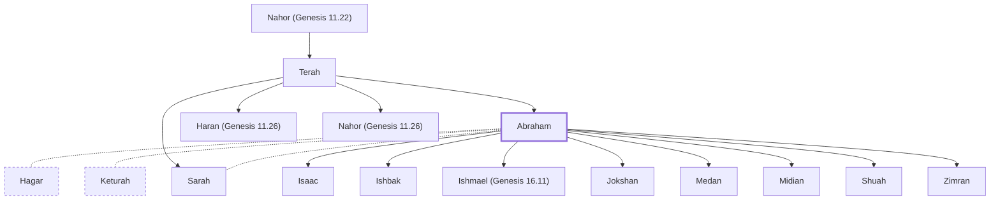

# Abraham

Patriarch, chosen by God to father His people

**Also called:** Abram

**Original-language names:** אַבְרָהָם (H0085) · אַבְרָם (H0087) · Ἀβραάμ (G0011)

## When

- **Lived:** [[connections/timeline/20th century BC|1996 BC]] – [[connections/timeline/19th century BC|1821 BC]] *(Jones)*
- **Placed around:** [[connections/timeline/19th century BC|1821 BC]] *(Ussher: the median date of the passages naming them)*

## Family

- **Father:** [[connections/people/Terah|Terah]]
- **Brothers and sisters:** [[connections/people/Haran (Genesis 11.26)|Haran (Genesis 11.26)]], [[connections/people/Nahor (Genesis 11.26)|Nahor (Genesis 11.26)]], [[connections/people/Sarah|Sarah]]
- **Spouses:** [[connections/people/Hagar|Hagar]], [[connections/people/Keturah|Keturah]], [[connections/people/Sarah|Sarah]]
- **Children:** [[connections/people/Isaac|Isaac]], [[connections/people/Ishbak|Ishbak]], [[connections/people/Ishmael (Genesis 16.11)|Ishmael (Genesis 16.11)]], [[connections/people/Jokshan|Jokshan]], [[connections/people/Medan|Medan]], [[connections/people/Midian|Midian]], [[connections/people/Shuah|Shuah]], [[connections/people/Zimran|Zimran]]
- **Tribe or nation:** Early Patriarch

**Line of descent** (21 generations, father to son): [[connections/people/Adam|Adam]] → [[connections/people/Seth|Seth]] → [[connections/people/Enosh|Enosh]] → [[connections/people/Kenan|Kenan]] → [[connections/people/Mahalalel (Genesis 5.12)|Mahalalel (Genesis 5.12)]] → [[connections/people/Jared|Jared]] → [[connections/people/Enoch (Genesis 5.18)|Enoch (Genesis 5.18)]] → [[connections/people/Methuselah|Methuselah]] → [[connections/people/Lamech (Genesis 5.25)|Lamech (Genesis 5.25)]] → [[connections/people/Noah (Genesis 5.29)|Noah (Genesis 5.29)]] → [[connections/people/Shem|Shem]] → [[connections/people/Arpachshad|Arpachshad]] → [[connections/people/Cainan|Cainan]] → [[connections/people/Shelah (Genesis 10.24)|Shelah (Genesis 10.24)]] → [[connections/people/Eber (Genesis 10.21)|Eber (Genesis 10.21)]] → [[connections/people/Peleg|Peleg]] → [[connections/people/Reu|Reu]] → [[connections/people/Serug|Serug]] → [[connections/people/Nahor (Genesis 11.22)|Nahor (Genesis 11.22)]] → [[connections/people/Terah|Terah]] → **Abraham**

**Family group:** [[connections/genealogy/Family of Adam|Family of Adam]], generation 21

## Events

- [[connections/timeline/20th century BC|1997 BC]] · [[connections/events/Lifetime of Abraham|Lifetime of Abraham]]
- [[connections/timeline/20th century BC|1996 BC]] · [[connections/events/Birth of Abraham|Birth of Abraham]]
- [[connections/timeline/20th century BC|1921 BC]] · [[connections/events/Abraham enters Canaan|Abraham enters Canaan]]
- [[connections/timeline/20th century BC|1921 BC]] · [[connections/events/Abrahamic Covenant|Abrahamic Covenant]]
- [[connections/timeline/20th century BC|1921 BC]] · [[connections/events/Abraham goes to Egypt|Abraham goes to Egypt]]
- [[connections/timeline/20th century BC|1921 BC]] · [[connections/events/Sojourn in Canaan and Egypt|Sojourn in Canaan and Egypt]]
- [[connections/timeline/20th century BC|1920 BC]] · [[connections/events/Abraham and Lot Separate|Abraham and Lot Separate]]
- [[connections/timeline/20th century BC|1910 BC]] · [[connections/events/Birth of Ishmael|Birth of Ishmael]]
- [[connections/timeline/19th century BC|1897 BC]] · [[connections/events/Sodom Destroyed|Sodom Destroyed]]
- [[connections/timeline/19th century BC|1896 BC]] · [[connections/events/Birth of Isaac|Birth of Isaac]]
- [[connections/timeline/19th century BC|1821 BC]] · [[connections/events/Death of Abraham|Death of Abraham]]

## Appears in

[[connections/chapters/01-genesis/Genesis 11|Genesis 11 (4)]] · [[connections/chapters/01-genesis/Genesis 12|Genesis 12 (11)]] · [[connections/chapters/01-genesis/Genesis 13|Genesis 13 (9)]] · [[connections/chapters/01-genesis/Genesis 14|Genesis 14 (7)]] · [[connections/chapters/01-genesis/Genesis 15|Genesis 15 (7)]] · [[connections/chapters/01-genesis/Genesis 16|Genesis 16 (7)]] · [[connections/chapters/01-genesis/Genesis 17|Genesis 17 (11)]] · [[connections/chapters/01-genesis/Genesis 18|Genesis 18 (12)]] · [[connections/chapters/01-genesis/Genesis 19|Genesis 19 (2)]] · [[connections/chapters/01-genesis/Genesis 20|Genesis 20 (8)]] · [[connections/chapters/01-genesis/Genesis 21|Genesis 21 (18)]] · [[connections/chapters/01-genesis/Genesis 22|Genesis 22 (16)]] · [[connections/chapters/01-genesis/Genesis 23|Genesis 23 (11)]] · [[connections/chapters/01-genesis/Genesis 24|Genesis 24 (12)]] · [[connections/chapters/01-genesis/Genesis 25|Genesis 25 (9)]] · [[connections/chapters/01-genesis/Genesis 26|Genesis 26 (6)]] · [[connections/chapters/01-genesis/Genesis 28|Genesis 28 (3)]] · [[connections/chapters/01-genesis/Genesis 31|Genesis 31 (2)]] · [[connections/chapters/01-genesis/Genesis 32|Genesis 32]] · [[connections/chapters/01-genesis/Genesis 35|Genesis 35 (2)]] · [[connections/chapters/01-genesis/Genesis 48|Genesis 48 (2)]] · [[connections/chapters/01-genesis/Genesis 49|Genesis 49 (2)]] · [[connections/chapters/01-genesis/Genesis 50|Genesis 50 (2)]] · [[connections/chapters/02-exodus/Exodus 2|Exodus 2]] · [[connections/chapters/02-exodus/Exodus 3|Exodus 3 (3)]] · [[connections/chapters/02-exodus/Exodus 4|Exodus 4]] · [[connections/chapters/02-exodus/Exodus 6|Exodus 6 (2)]] · [[connections/chapters/02-exodus/Exodus 32|Exodus 32]] · [[connections/chapters/02-exodus/Exodus 33|Exodus 33]] · [[connections/chapters/03-leviticus/Leviticus 26|Leviticus 26]] · [[connections/chapters/04-numbers/Numbers 32|Numbers 32]] · [[connections/chapters/05-deuteronomy/Deuteronomy 1|Deuteronomy 1]] · [[connections/chapters/05-deuteronomy/Deuteronomy 6|Deuteronomy 6]] · [[connections/chapters/05-deuteronomy/Deuteronomy 9|Deuteronomy 9 (2)]] · [[connections/chapters/05-deuteronomy/Deuteronomy 29|Deuteronomy 29]] · [[connections/chapters/05-deuteronomy/Deuteronomy 30|Deuteronomy 30]] · [[connections/chapters/05-deuteronomy/Deuteronomy 34|Deuteronomy 34]] · [[connections/chapters/06-joshua/Joshua 24|Joshua 24 (2)]] · [[connections/chapters/11-1-kings/1 Kings 18|1 Kings 18]] · [[connections/chapters/12-2-kings/2 Kings 13|2 Kings 13]] · [[connections/chapters/13-1-chronicles/1 Chronicles 1|1 Chronicles 1 (4)]] · [[connections/chapters/13-1-chronicles/1 Chronicles 16|1 Chronicles 16]] · [[connections/chapters/13-1-chronicles/1 Chronicles 29|1 Chronicles 29]] · [[connections/chapters/14-2-chronicles/2 Chronicles 20|2 Chronicles 20]] · [[connections/chapters/14-2-chronicles/2 Chronicles 30|2 Chronicles 30]] · [[connections/chapters/16-nehemiah/Nehemiah 9|Nehemiah 9]] · [[connections/chapters/19-psalms/Psalms 47|Psalms 47]] · [[connections/chapters/19-psalms/Psalms 105|Psalms 105 (3)]] · [[connections/chapters/23-isaiah/Isaiah 29|Isaiah 29]] · [[connections/chapters/23-isaiah/Isaiah 41|Isaiah 41]] · [[connections/chapters/23-isaiah/Isaiah 51|Isaiah 51]] · [[connections/chapters/23-isaiah/Isaiah 63|Isaiah 63]] · [[connections/chapters/24-jeremiah/Jeremiah 33|Jeremiah 33]] · [[connections/chapters/26-ezekiel/Ezekiel 33|Ezekiel 33]] · [[connections/chapters/33-micah/Micah 7|Micah 7]] · [[connections/chapters/40-matthew/Matthew 1|Matthew 1 (3)]] · [[connections/chapters/40-matthew/Matthew 3|Matthew 3]] · [[connections/chapters/40-matthew/Matthew 8|Matthew 8]] · [[connections/chapters/40-matthew/Matthew 22|Matthew 22]] · [[connections/chapters/41-mark/Mark 12|Mark 12]] · [[connections/chapters/42-luke/Luke 1|Luke 1 (2)]] · [[connections/chapters/42-luke/Luke 3|Luke 3 (2)]] · [[connections/chapters/42-luke/Luke 13|Luke 13 (2)]] · [[connections/chapters/42-luke/Luke 16|Luke 16 (6)]] · [[connections/chapters/42-luke/Luke 19|Luke 19]] · [[connections/chapters/42-luke/Luke 20|Luke 20]] · [[connections/chapters/43-john/John 8|John 8 (9)]] · [[connections/chapters/44-acts/Acts 3|Acts 3 (2)]] · [[connections/chapters/44-acts/Acts 7|Acts 7 (4)]] · [[connections/chapters/44-acts/Acts 13|Acts 13]] · [[connections/chapters/45-romans/Romans 4|Romans 4 (7)]] · [[connections/chapters/45-romans/Romans 9|Romans 9]] · [[connections/chapters/45-romans/Romans 11|Romans 11]] · [[connections/chapters/47-2-corinthians/2 Corinthians 11|2 Corinthians 11]] · [[connections/chapters/48-galatians/Galatians 3|Galatians 3 (8)]] · [[connections/chapters/48-galatians/Galatians 4|Galatians 4]] · [[connections/chapters/58-hebrews/Hebrews 2|Hebrews 2]] · [[connections/chapters/58-hebrews/Hebrews 6|Hebrews 6]] · [[connections/chapters/58-hebrews/Hebrews 7|Hebrews 7 (6)]] · [[connections/chapters/58-hebrews/Hebrews 11|Hebrews 11 (2)]] · [[connections/chapters/59-james/James 2|James 2 (2)]] · [[connections/chapters/60-1-peter/1 Peter 3|1 Peter 3]]

## Appears in the same verse as

[[connections/people/Isaac|Isaac (66)]] · [[connections/people/Israel|Israel (45)]] · [[connections/people/Sarah|Sarah (29)]] · [[connections/people/Lot|Lot (12)]] · [[connections/people/Abimelech (Genesis 20.2)|Abimelech (Genesis 20.2) (11)]] · [[connections/people/Jesus|Jesus (9)]] · [[connections/places/Canaan|Canaan (9)]] · [[connections/people/Heth|Heth (8)]] · [[connections/people/Ishmael (Genesis 16.11)|Ishmael (Genesis 16.11) (8)]] · [[connections/places/Egypt|Egypt (8)]] · [[connections/people/Hagar|Hagar (7)]] · [[connections/people/Moses|Moses (7)]] · [[connections/people/Nahor (Genesis 11.26)|Nahor (Genesis 11.26) (7)]] · [[connections/places/Mamre|Mamre (6)]] · [[connections/places/Sodom|Sodom (6)]] · [[connections/people/Ephron|Ephron (5)]] · [[connections/people/Terah|Terah (5)]] · [[connections/people/Haran (Genesis 11.26)|Haran (Genesis 11.26) (4)]] · [[connections/people/Milcah (Genesis 11.29)|Milcah (Genesis 11.29) (4)]] · [[connections/people/Rebekah|Rebekah (4)]] · [[connections/places/Haran|Haran (4)]] · [[connections/places/Hebron|Hebron (4)]] · [[connections/people/David|David (3)]] · [[connections/people/Lazarus (Luke 16.20)|Lazarus (Luke 16.20) (3)]] · [[connections/places/Euphrates|Euphrates (3)]] · [[connections/places/Gerar|Gerar (3)]] · [[connections/places/Machpelah|Machpelah (3)]] · [[connections/places/Negeb|Negeb (3)]] · [[connections/people/Bethuel|Bethuel (2)]] · [[connections/people/Esau|Esau (2)]] · [[connections/people/Joseph (Genesis 30.24)|Joseph (Genesis 30.24) (2)]] · [[connections/people/Judah (Genesis 29.35)|Judah (Genesis 29.35) (2)]] · [[connections/people/Keturah|Keturah (2)]] · [[connections/people/Levi (Genesis 29.34)|Levi (Genesis 29.34) (2)]] · [[connections/people/Nahor (Genesis 11.22)|Nahor (Genesis 11.22) (2)]] · [[connections/people/Pharaoh (Genesis 12.15)|Pharaoh (Genesis 12.15) (2)]] · [[connections/places/Beersheba|Beersheba (2)]] · [[connections/places/Chaldea|Chaldea (2)]] · [[connections/places/Jerusalem|Jerusalem (2)]] · [[connections/places/Shechem|Shechem (2)]] · [[connections/places/Ur|Ur (2)]] · [[connections/people/Aner|Aner]] · [[connections/people/Benjamin (Genesis 35.18)|Benjamin (Genesis 35.18)]] · [[connections/people/Dedan (Genesis 25.3)|Dedan (Genesis 25.3)]] · [[connections/people/Eliezer (Genesis 15.2)|Eliezer (Genesis 15.2)]] · [[connections/people/Elijah (1 Kings 17.1)|Elijah (1 Kings 17.1)]] · [[connections/people/Eshcol|Eshcol]] · [[connections/people/Hamor|Hamor]] · [[connections/people/Hebrews|Hebrews]] · [[connections/people/Iscah|Iscah]] · [[connections/people/Ishbak|Ishbak]] · [[connections/people/Jokshan|Jokshan]] · [[connections/people/Joshua (Exodus 17.9)|Joshua (Exodus 17.9)]] · [[connections/people/Leah|Leah]] · [[connections/people/Mahalath (Genesis 28.9)|Mahalath (Genesis 28.9)]] · [[connections/people/Mamre|Mamre]] · [[connections/people/Medan|Medan]] · [[connections/people/Melchizedek|Melchizedek]] · [[connections/people/Midian|Midian]] · [[connections/people/Nebaioth|Nebaioth]] · [[connections/people/Phicol|Phicol]] · [[connections/people/Pilate|Pilate]] · [[connections/people/Sheba (Genesis 25.3)|Sheba (Genesis 25.3)]] · [[connections/people/Shuah|Shuah]] · [[connections/people/Zimran|Zimran]] · [[connections/places/Assyria|Assyria]] · [[connections/places/Babylon|Babylon]] · [[connections/places/Beer-lahai-roi|Beer-lahai-roi]] · [[connections/places/Damascus|Damascus]] · [[connections/places/Dan|Dan]] · [[connections/places/Kadesh|Kadesh]] · [[connections/places/Mesopotamia|Mesopotamia]] · [[connections/places/Moreh (Genesis 12.6)|Moreh (Genesis 12.6)]] · [[connections/places/Shur|Shur]]
