# Absalom

David's rebellious son who tried to usurp the throne.

**Also called:** Abishalom

**Original-language names:** אַבְשָׁלוֹם (H0053) · אֲבִישָׁלוֹם (H0053)

## When

- **Placed around:** [[connections/timeline/11th century BC|1023 BC]] *(Ussher: the median date of the passages naming them)*

## Family

- **Father:** [[connections/people/David|David]]
- **Mother:** [[connections/people/Maacah (2 Samuel 3.3)|Maacah (2 Samuel 3.3)]]
- **Brothers and sisters:** [[connections/people/Adonijah (2 Samuel 3.4)|Adonijah (2 Samuel 3.4)]], [[connections/people/Amnon (2 Samuel 3.2)|Amnon (2 Samuel 3.2)]], [[connections/people/Chileab|Chileab]], [[connections/people/Eliada (2 Samuel 5.16)|Eliada (2 Samuel 5.16)]], [[connections/people/Eliphelet (2 Samuel 5.16)|Eliphelet (2 Samuel 5.16)]], [[connections/people/Elishama (2 Samuel 5.16)|Elishama (2 Samuel 5.16)]], [[connections/people/Elishua|Elishua]], [[connections/people/Elpelet|Elpelet]], [[connections/people/Ibhar|Ibhar]], [[connections/people/Ithream|Ithream]], [[connections/people/Japhia (2 Samuel 5.15)|Japhia (2 Samuel 5.15)]], [[connections/people/Jerimoth (2 Chronicles 11.18)|Jerimoth (2 Chronicles 11.18)]], [[connections/people/Nathan (2 Samuel 5.14)|Nathan (2 Samuel 5.14)]], [[connections/people/Nepheg (2 Samuel 5.15)|Nepheg (2 Samuel 5.15)]], [[connections/people/Nogah|Nogah]], [[connections/people/Shammua (2 Samuel 5.14)|Shammua (2 Samuel 5.14)]], [[connections/people/Shephatiah (2 Samuel 3.4)|Shephatiah (2 Samuel 3.4)]], [[connections/people/Shobab (2 Samuel 5.14)|Shobab (2 Samuel 5.14)]], [[connections/people/Solomon|Solomon]], [[connections/people/Tamar (2 Samuel 13.1)|Tamar (2 Samuel 13.1)]]
- **Children:** [[connections/people/Tamar (2 Samuel 14.27)|Tamar (2 Samuel 14.27)]]
- **Tribe or nation:** Tribe of Judah

**Line of descent** (35 generations, father to son): [[connections/people/Adam|Adam]] → [[connections/people/Seth|Seth]] → [[connections/people/Enosh|Enosh]] → [[connections/people/Kenan|Kenan]] → [[connections/people/Mahalalel (Genesis 5.12)|Mahalalel (Genesis 5.12)]] → [[connections/people/Jared|Jared]] → [[connections/people/Enoch (Genesis 5.18)|Enoch (Genesis 5.18)]] → [[connections/people/Methuselah|Methuselah]] → [[connections/people/Lamech (Genesis 5.25)|Lamech (Genesis 5.25)]] → [[connections/people/Noah (Genesis 5.29)|Noah (Genesis 5.29)]] → [[connections/people/Shem|Shem]] → [[connections/people/Arpachshad|Arpachshad]] → [[connections/people/Cainan|Cainan]] → [[connections/people/Shelah (Genesis 10.24)|Shelah (Genesis 10.24)]] → [[connections/people/Eber (Genesis 10.21)|Eber (Genesis 10.21)]] → [[connections/people/Peleg|Peleg]] → [[connections/people/Reu|Reu]] → [[connections/people/Serug|Serug]] → [[connections/people/Nahor (Genesis 11.22)|Nahor (Genesis 11.22)]] → [[connections/people/Terah|Terah]] → [[connections/people/Abraham|Abraham]] → [[connections/people/Isaac|Isaac]] → [[connections/people/Israel|Israel]] → [[connections/people/Judah (Genesis 29.35)|Judah (Genesis 29.35)]] → [[connections/people/Perez|Perez]] → [[connections/people/Hezron (Genesis 46.12)|Hezron (Genesis 46.12)]] → [[connections/people/Ram (Ruth 4.19)|Ram (Ruth 4.19)]] → [[connections/people/Amminadab (Exodus 6.23)|Amminadab (Exodus 6.23)]] → [[connections/people/Nahshon|Nahshon]] → [[connections/people/Salmon|Salmon]] → [[connections/people/Boaz|Boaz]] → [[connections/people/Obed (Ruth 4.17)|Obed (Ruth 4.17)]] → [[connections/people/Jesse|Jesse]] → [[connections/people/David|David]] → **Absalom**

**Family group:** [[connections/genealogy/Family of Adam|Family of Adam]], generation 35

```mermaid
flowchart TB
  n0["Absalom"]:::me
  n1["Jesse"]
  n2["David"]
  n1 --> n2
  n3["Nahash (2 Samuel 17.25)"]
  n3 --> n2
  n2 --> n0
  n4["Talmai (2 Samuel 3.3)"]
  n5["Maacah (2 Samuel 3.3)"]
  n4 --> n5
  n5 --> n0
  n6["Adonijah (2 Samuel 3.4)"]
  n2 --> n6
  n7["Amnon (2 Samuel 3.2)"]
  n2 --> n7
  n8["Chileab"]
  n2 --> n8
  n9["Eliada (2 Samuel 5.16)"]
  n2 --> n9
  n10["Eliphelet (2 Samuel 5.16)"]
  n2 --> n10
  n11["Elishama (2 Samuel 5.16)"]
  n2 --> n11
  n12["Elishua"]
  n2 --> n12
  n13["Elpelet"]
  n2 --> n13
  n14["Ibhar"]
  n2 --> n14
  n15["Ithream"]
  n2 --> n15
  n16["Japhia (2 Samuel 5.15)"]
  n2 --> n16
  n17["Jerimoth (2 Chronicles 11.18)"]
  n2 --> n17
  n18["Nathan (2 Samuel 5.14)"]
  n2 --> n18
  n19["Nepheg (2 Samuel 5.15)"]
  n2 --> n19
  n20["Nogah"]
  n2 --> n20
  n21["Shammua (2 Samuel 5.14)"]
  n2 --> n21
  n22["Shephatiah (2 Samuel 3.4)"]
  n2 --> n22
  n23["Shobab (2 Samuel 5.14)"]
  n2 --> n23
  n24["Solomon"]
  n2 --> n24
  n25["Tamar (2 Samuel 13.1)"]
  n2 --> n25
  n26["Tamar (2 Samuel 14.27)"]
  n0 --> n26
  classDef me stroke-width:3px
  classDef spouse stroke-dasharray:4
```

## Appears in

[[connections/chapters/10-2-samuel/2 Samuel 3|2 Samuel 3]] · [[connections/chapters/10-2-samuel/2 Samuel 13|2 Samuel 13 (17)]] · [[connections/chapters/10-2-samuel/2 Samuel 14|2 Samuel 14 (12)]] · [[connections/chapters/10-2-samuel/2 Samuel 15|2 Samuel 15 (14)]] · [[connections/chapters/10-2-samuel/2 Samuel 16|2 Samuel 16 (9)]] · [[connections/chapters/10-2-samuel/2 Samuel 17|2 Samuel 17 (13)]] · [[connections/chapters/10-2-samuel/2 Samuel 18|2 Samuel 18 (10)]] · [[connections/chapters/10-2-samuel/2 Samuel 19|2 Samuel 19 (6)]] · [[connections/chapters/10-2-samuel/2 Samuel 20|2 Samuel 20]] · [[connections/chapters/11-1-kings/1 Kings 1|1 Kings 1]] · [[connections/chapters/11-1-kings/1 Kings 2|1 Kings 2 (2)]] · [[connections/chapters/11-1-kings/1 Kings 15|1 Kings 15 (2)]] · [[connections/chapters/13-1-chronicles/1 Chronicles 3|1 Chronicles 3]] · [[connections/chapters/14-2-chronicles/2 Chronicles 11|2 Chronicles 11 (2)]] · [[connections/chapters/19-psalms/Psalms 3|Psalms 3]]

## Appears in the same verse as

[[connections/people/Joab (1 Samuel 26.6)|Joab (1 Samuel 26.6) (17)]] · [[connections/people/David|David (16)]] · [[connections/people/Israel|Israel (16)]] · [[connections/people/Ahithophel|Ahithophel (12)]] · [[connections/people/Amnon (2 Samuel 3.2)|Amnon (2 Samuel 3.2) (10)]] · [[connections/people/Hushai|Hushai (9)]] · [[connections/places/Jerusalem|Jerusalem (9)]] · [[connections/places/Geshur|Geshur (6)]] · [[connections/people/Tamar (2 Samuel 13.1)|Tamar (2 Samuel 13.1) (5)]] · [[connections/people/Maacah (1 Kings 15.2)|Maacah (1 Kings 15.2) (4)]] · [[connections/people/Abishai|Abishai (3)]] · [[connections/people/Talmai (2 Samuel 3.3)|Talmai (2 Samuel 3.3) (3)]] · [[connections/people/Adonijah (2 Samuel 3.4)|Adonijah (2 Samuel 3.4) (2)]] · [[connections/people/Ahimaaz (2 Samuel 15.27)|Ahimaaz (2 Samuel 15.27) (2)]] · [[connections/people/Ittai (2 Samuel 15.19)|Ittai (2 Samuel 15.19) (2)]] · [[connections/people/Maacah (2 Samuel 3.3)|Maacah (2 Samuel 3.3) (2)]] · [[connections/people/Zeruiah|Zeruiah (2)]] · [[connections/places/Hebron|Hebron (2)]] · [[connections/people/Abiathar|Abiathar]] · [[connections/people/Abigail (1 Samuel 25.3)|Abigail (1 Samuel 25.3)]] · [[connections/people/Abigail (2 Samuel 17.25)|Abigail (2 Samuel 17.25)]] · [[connections/people/Abijah (1 Kings 14.31)|Abijah (1 Kings 14.31)]] · [[connections/people/Amasa (2 Samuel 17.25)|Amasa (2 Samuel 17.25)]] · [[connections/people/Ammihud (2 Samuel 13.37)|Ammihud (2 Samuel 13.37)]] · [[connections/people/Attai (2 Chronicles 11.20)|Attai (2 Chronicles 11.20)]] · [[connections/people/Barzillai (2 Samuel 17.27)|Barzillai (2 Samuel 17.27)]] · [[connections/people/Bichri|Bichri]] · [[connections/people/Chileab|Chileab]] · [[connections/people/Haggith|Haggith]] · [[connections/people/Jether (2 Samuel 17.25)|Jether (2 Samuel 17.25)]] · [[connections/people/Jonadab (2 Samuel 13.3)|Jonadab (2 Samuel 13.3)]] · [[connections/people/Jonathan (2 Samuel 15.27)|Jonathan (2 Samuel 15.27)]] · [[connections/people/Nabal|Nabal]] · [[connections/people/Nahash (2 Samuel 17.25)|Nahash (2 Samuel 17.25)]] · [[connections/people/Rehoboam|Rehoboam]] · [[connections/people/Saul|Saul]] · [[connections/people/Sheba (2 Samuel 20.1)|Sheba (2 Samuel 20.1)]] · [[connections/people/Shelomith (2 Chronicles 11.20)|Shelomith (2 Chronicles 11.20)]] · [[connections/people/Shimeah (1 Samuel 16.9)|Shimeah (1 Samuel 16.9)]] · [[connections/people/Tamar (2 Samuel 14.27)|Tamar (2 Samuel 14.27)]] · [[connections/people/Zadok (2 Samuel 8.17)|Zadok (2 Samuel 8.17)]] · [[connections/people/Ziza (2 Chronicles 11.20)|Ziza (2 Chronicles 11.20)]] · [[connections/places/Baal-hazor|Baal-hazor]] · [[connections/places/Bahurim|Bahurim]] · [[connections/places/Ephraim|Ephraim]] · [[connections/places/Gilead|Gilead]] · [[connections/places/Giloh|Giloh]] · [[connections/places/Horonaim|Horonaim]] · [[connections/places/Jordan|Jordan]] · [[connections/places/King's Valley|King's Valley]] · [[connections/places/Mahanaim|Mahanaim]]
