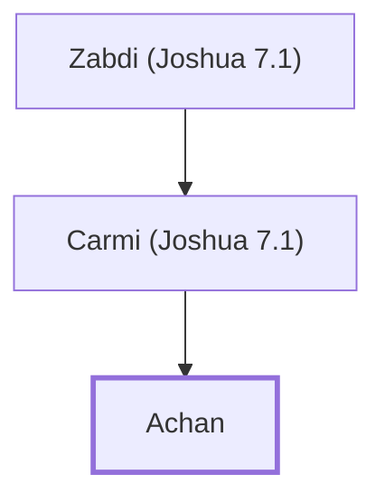

# Achan

An Israelite who stole devoted things, causing Israel's defeat.

**Original-language names:** עָכָן (H5912) · עָכָר (H5917)

## When

- **Placed around:** [[connections/timeline/15th century BC|1451 BC]] *(Ussher: the median date of the passages naming them)*

## Family

- **Father:** [[connections/people/Carmi (Joshua 7.1)|Carmi (Joshua 7.1)]]
- **Tribe or nation:** Tribe of Judah

**Line of descent** (28 generations, father to son): [[connections/people/Adam|Adam]] → [[connections/people/Seth|Seth]] → [[connections/people/Enosh|Enosh]] → [[connections/people/Kenan|Kenan]] → [[connections/people/Mahalalel (Genesis 5.12)|Mahalalel (Genesis 5.12)]] → [[connections/people/Jared|Jared]] → [[connections/people/Enoch (Genesis 5.18)|Enoch (Genesis 5.18)]] → [[connections/people/Methuselah|Methuselah]] → [[connections/people/Lamech (Genesis 5.25)|Lamech (Genesis 5.25)]] → [[connections/people/Noah (Genesis 5.29)|Noah (Genesis 5.29)]] → [[connections/people/Shem|Shem]] → [[connections/people/Arpachshad|Arpachshad]] → [[connections/people/Cainan|Cainan]] → [[connections/people/Shelah (Genesis 10.24)|Shelah (Genesis 10.24)]] → [[connections/people/Eber (Genesis 10.21)|Eber (Genesis 10.21)]] → [[connections/people/Peleg|Peleg]] → [[connections/people/Reu|Reu]] → [[connections/people/Serug|Serug]] → [[connections/people/Nahor (Genesis 11.22)|Nahor (Genesis 11.22)]] → [[connections/people/Terah|Terah]] → [[connections/people/Abraham|Abraham]] → [[connections/people/Isaac|Isaac]] → [[connections/people/Israel|Israel]] → [[connections/people/Judah (Genesis 29.35)|Judah (Genesis 29.35)]] → [[connections/people/Zerah (Genesis 38.30)|Zerah (Genesis 38.30)]] → [[connections/people/Zabdi (Joshua 7.1)|Zabdi (Joshua 7.1)]] → [[connections/people/Carmi (Joshua 7.1)|Carmi (Joshua 7.1)]] → **Achan**

**Family group:** [[connections/genealogy/Family of Adam|Family of Adam]], generation 28

## Appears in

[[connections/chapters/06-joshua/Joshua 7|Joshua 7 (5)]] · [[connections/chapters/06-joshua/Joshua 22|Joshua 22]] · [[connections/chapters/13-1-chronicles/1 Chronicles 2|1 Chronicles 2]]

## Appears in the same verse as

[[connections/people/Israel|Israel (6)]] · [[connections/people/Zerah (Genesis 38.30)|Zerah (Genesis 38.30) (4)]] · [[connections/people/Carmi (Joshua 7.1)|Carmi (Joshua 7.1) (3)]] · [[connections/people/Joshua (Exodus 17.9)|Joshua (Exodus 17.9) (3)]] · [[connections/people/Judah (Genesis 29.35)|Judah (Genesis 29.35) (2)]] · [[connections/people/Zabdi (Joshua 7.1)|Zabdi (Joshua 7.1) (2)]] · [[connections/places/Achor Valley|Achor Valley]]
