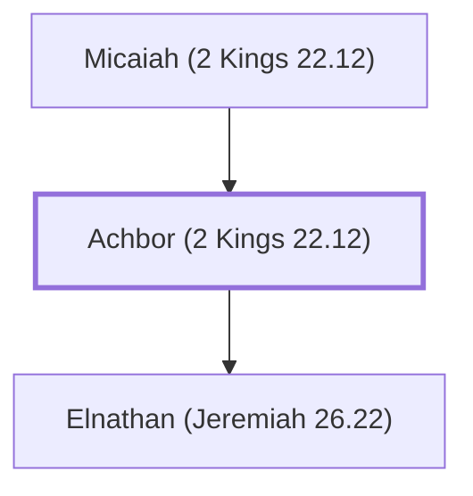

# Achbor (2 Kings 22.12)

Official during the reign of King Josiah

**Also called:** Abdon

**Original-language names:** עַכְבּוֹר (H5907) · עַבְדּוֹן (H5658)

## When

- **Placed around:** [[connections/timeline/7th century BC|624 BC]] *(Ussher: the median date of the passages naming them)*

## Family

- **Father:** [[connections/people/Micaiah (2 Kings 22.12)|Micaiah (2 Kings 22.12)]]
- **Children:** [[connections/people/Elnathan (Jeremiah 26.22)|Elnathan (Jeremiah 26.22)]]

**Family group:** [[connections/genealogy/Family of Micaiah (2 Kings 22.12)|Family of Micaiah (2 Kings 22.12)]], generation 2

## Appears in

[[connections/chapters/12-2-kings/2 Kings 22|2 Kings 22 (2)]] · [[connections/chapters/14-2-chronicles/2 Chronicles 34|2 Chronicles 34]] · [[connections/chapters/24-jeremiah/Jeremiah 26|Jeremiah 26]] · [[connections/chapters/24-jeremiah/Jeremiah 36|Jeremiah 36]]

## Appears in the same verse as

[[connections/people/Shaphan (2 Kings 22.3)|Shaphan (2 Kings 22.3) (4)]] · [[connections/people/Ahikam|Ahikam (3)]] · [[connections/people/Asaiah (2 Kings 22.12)|Asaiah (2 Kings 22.12) (3)]] · [[connections/people/Hilkiah (2 Kings 22.4)|Hilkiah (2 Kings 22.4) (3)]] · [[connections/people/Elnathan (Jeremiah 26.22)|Elnathan (Jeremiah 26.22) (2)]] · [[connections/people/Micaiah (2 Kings 22.12)|Micaiah (2 Kings 22.12) (2)]] · [[connections/people/Delaiah (Jeremiah 36.12)|Delaiah (Jeremiah 36.12)]] · [[connections/people/Elishama (Jeremiah 36.12)|Elishama (Jeremiah 36.12)]] · [[connections/people/Gemariah (Jeremiah 36.10)|Gemariah (Jeremiah 36.10)]] · [[connections/people/Hananiah (Jeremiah 36.12)|Hananiah (Jeremiah 36.12)]] · [[connections/people/Harhas|Harhas]] · [[connections/people/Huldah|Huldah]] · [[connections/people/Jehoiakim|Jehoiakim]] · [[connections/people/Shallum (2 Kings 22.14)|Shallum (2 Kings 22.14)]] · [[connections/people/Shemaiah (Jeremiah 36.12)|Shemaiah (Jeremiah 36.12)]] · [[connections/people/Tikvah (2 Kings 22.14)|Tikvah (2 Kings 22.14)]] · [[connections/people/Zedekiah (Jeremiah 36.12)|Zedekiah (Jeremiah 36.12)]] · [[connections/places/Egypt|Egypt]] · [[connections/places/Jerusalem|Jerusalem]] · [[connections/places/Second Quarter|Second Quarter]]
