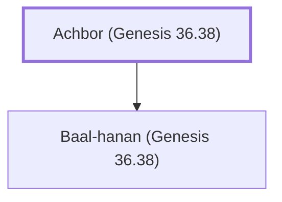

# Achbor (Genesis 36.38)

Edomite king, son of Baal-hanan

**Original-language names:** עַכְבּוֹר (H5907)

## When

- **Placed around:** [[connections/timeline/17th century BC|1659 BC]] *(Ussher: the median date of the passages naming them)*

## Family

- **Children:** [[connections/people/Baal-hanan (Genesis 36.38)|Baal-hanan (Genesis 36.38)]]
- **Tribe or nation:** Edom

**Family group:** [[connections/genealogy/Family of Achbor (Genesis 36.38)|Family of Achbor (Genesis 36.38)]], generation 1

## Appears in

[[connections/chapters/01-genesis/Genesis 36|Genesis 36 (2)]] · [[connections/chapters/13-1-chronicles/1 Chronicles 1|1 Chronicles 1]]

## Appears in the same verse as

[[connections/people/Baal-hanan (Genesis 36.38)|Baal-hanan (Genesis 36.38) (3)]] · [[connections/people/Shaul (Genesis 36.37)|Shaul (Genesis 36.37) (2)]] · [[connections/people/Hadad (Genesis 36.39)|Hadad (Genesis 36.39)]] · [[connections/people/Matred|Matred]] · [[connections/people/Mehetabel (Genesis 36.39)|Mehetabel (Genesis 36.39)]] · [[connections/people/Mezahab|Mezahab]] · [[connections/places/Pau|Pau]]
