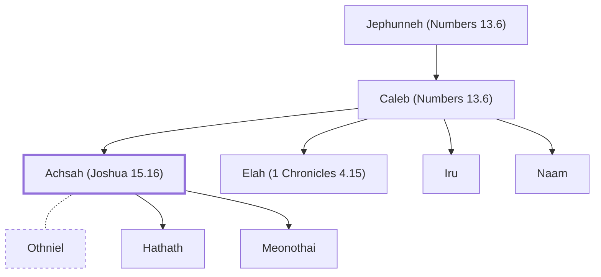

# Achsah (Joshua 15.16)

Daughter of Caleb; wife of Othniel

**Original-language names:** עַכְסָה (H5915)

## When

- **Placed around:** [[connections/timeline/15th century BC|1443 BC]] *(Ussher: the median date of the passages naming them)*

## Family

- **Father:** [[connections/people/Caleb (Numbers 13.6)|Caleb (Numbers 13.6)]]
- **Brothers and sisters:** [[connections/people/Elah (1 Chronicles 4.15)|Elah (1 Chronicles 4.15)]], [[connections/people/Iru|Iru]], [[connections/people/Naam|Naam]]
- **Spouses:** [[connections/people/Othniel|Othniel]]
- **Children:** [[connections/people/Hathath|Hathath]], [[connections/people/Meonothai|Meonothai (uncertain)]]

**Line of descent** (3 generations, father to son): [[connections/people/Jephunneh (Numbers 13.6)|Jephunneh (Numbers 13.6)]] → [[connections/people/Caleb (Numbers 13.6)|Caleb (Numbers 13.6)]] → **Achsah (Joshua 15.16)**

**Family group:** [[connections/genealogy/Family of Jephunneh (Numbers 13.6)|Family of Jephunneh (Numbers 13.6)]], generation 3

## Appears in

[[connections/chapters/06-joshua/Joshua 15|Joshua 15 (2)]] · [[connections/chapters/07-judges/Judges 1|Judges 1 (2)]]

## Appears in the same verse as

[[connections/people/Caleb (Numbers 13.6)|Caleb (Numbers 13.6) (4)]] · [[connections/people/Kenaz (Joshua 15.17)|Kenaz (Joshua 15.17) (2)]] · [[connections/people/Othniel|Othniel (2)]] · [[connections/places/Debir (Joshua 10.38)|Debir (Joshua 10.38) (2)]]
