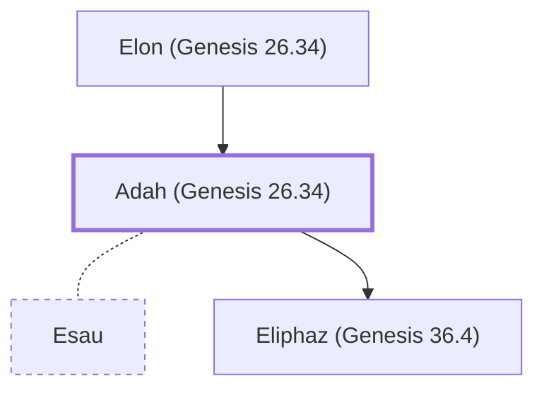

# Adah (Genesis 26.34)

Hittite wife of Esau; mother of Eliphaz

**Also called:** Basemath

**Original-language names:** עָדָה (H5711) · בָּֽשְׂמַת (H1315)

## When

- **Placed around:** [[connections/timeline/18th century BC|1774 BC]] *(Ussher: the median date of the passages naming them)*

## Family

- **Father:** [[connections/people/Elon (Genesis 26.34)|Elon (Genesis 26.34)]]
- **Spouses:** [[connections/people/Esau|Esau]]
- **Children:** [[connections/people/Eliphaz (Genesis 36.4)|Eliphaz (Genesis 36.4)]]
- **Tribe or nation:** Edom

**Family group:** [[connections/genealogy/Family of Adam|Family of Adam]], generation 2

## Appears in

[[connections/chapters/01-genesis/Genesis 26|Genesis 26]] · [[connections/chapters/01-genesis/Genesis 36|Genesis 36 (5)]]

## Appears in the same verse as

[[connections/people/Esau|Esau (5)]] · [[connections/people/Eliphaz (Genesis 36.4)|Eliphaz (Genesis 36.4) (4)]] · [[connections/people/Amalek|Amalek (2)]] · [[connections/people/Elon (Genesis 26.34)|Elon (Genesis 26.34) (2)]] · [[connections/people/Mahalath (Genesis 28.9)|Mahalath (Genesis 28.9) (2)]] · [[connections/people/Reuel (Genesis 36.4)|Reuel (Genesis 36.4) (2)]] · [[connections/people/Anah|Anah]] · [[connections/people/Beeri (Genesis 26.34)|Beeri (Genesis 26.34)]] · [[connections/people/Gatam|Gatam]] · [[connections/people/Judith|Judith]] · [[connections/people/Korah (Genesis 36.16)|Korah (Genesis 36.16)]] · [[connections/people/Oholibamah|Oholibamah]] · [[connections/people/Timna|Timna]] · [[connections/people/Zibeon|Zibeon]] · [[connections/places/Canaan|Canaan]] · [[connections/places/Edom|Edom]]
