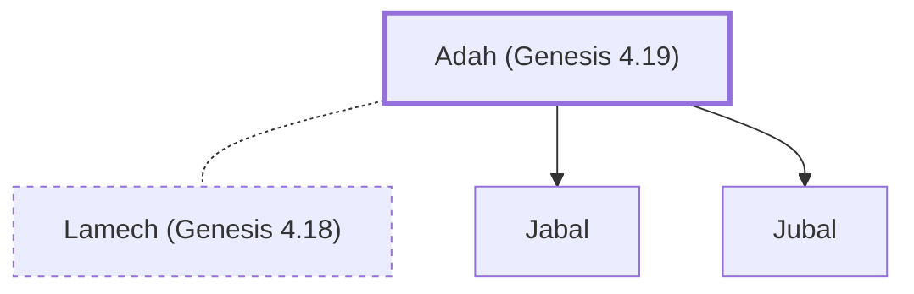

# Adah (Genesis 4.19)

Wife of Lamech; mother of Jabal and Jubal

**Original-language names:** עָדָה (H5711)

## When

- **Placed around:** [[connections/timeline/41st century BC|4003 BC]] *(Ussher: the median date of the passages naming them)*

## Family

- **Spouses:** [[connections/people/Lamech (Genesis 4.18)|Lamech (Genesis 4.18)]]
- **Children:** [[connections/people/Jabal|Jabal]], [[connections/people/Jubal|Jubal]]

**Family group:** [[connections/genealogy/Family of Adam|Family of Adam]], generation 7

## Appears in

[[connections/chapters/01-genesis/Genesis 4|Genesis 4 (3)]]

## Appears in the same verse as

[[connections/people/Lamech (Genesis 4.18)|Lamech (Genesis 4.18) (2)]] · [[connections/people/Zillah|Zillah (2)]] · [[connections/people/Jabal|Jabal]]
