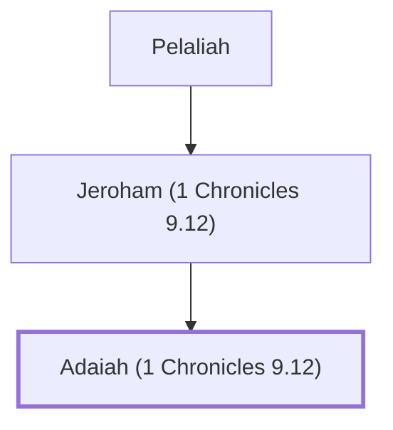

# Adaiah (1 Chronicles 9.12)

Priest, descendant of Malchijah, during the post-exilic period

**Original-language names:** עֲדָיָ֫הוּ (H5718)

## When

- **Placed around:** [[connections/timeline/5th century BC|445 BC]] *(Ussher: the median date of the passages naming them)*

## Family

- **Father:** [[connections/people/Jeroham (1 Chronicles 9.12)|Jeroham (1 Chronicles 9.12)]]
- **Tribe or nation:** Tribe of Levi

**Line of descent** (8 generations, father to son): [[connections/people/Hammelech|Hammelech]] → [[connections/people/Malchijah (1 Chronicles 9.12)|Malchijah (1 Chronicles 9.12)]] → [[connections/people/Pashhur (1 Chronicles 9.12)|Pashhur (1 Chronicles 9.12)]] → [[connections/people/Zechariah (Nehemiah 11.12)|Zechariah (Nehemiah 11.12)]] → [[connections/people/Amzi (Nehemiah 11.12)|Amzi (Nehemiah 11.12)]] → [[connections/people/Pelaliah|Pelaliah]] → [[connections/people/Jeroham (1 Chronicles 9.12)|Jeroham (1 Chronicles 9.12)]] → **Adaiah (1 Chronicles 9.12)**

**Family group:** [[connections/genealogy/Family of Hammelech|Family of Hammelech]], generation 8

## Appears in

[[connections/chapters/13-1-chronicles/1 Chronicles 9|1 Chronicles 9]] · [[connections/chapters/16-nehemiah/Nehemiah 11|Nehemiah 11]]

## Appears in the same verse as

[[connections/people/Jeroham (1 Chronicles 9.12)|Jeroham (1 Chronicles 9.12) (2)]] · [[connections/people/Malchijah (1 Chronicles 9.12)|Malchijah (1 Chronicles 9.12) (2)]] · [[connections/people/Pashhur (1 Chronicles 9.12)|Pashhur (1 Chronicles 9.12) (2)]] · [[connections/people/Adiel (1 Chronicles 9.12)|Adiel (1 Chronicles 9.12)]] · [[connections/people/Amzi (Nehemiah 11.12)|Amzi (Nehemiah 11.12)]] · [[connections/people/Immer (1 Chronicles 9.12)|Immer (1 Chronicles 9.12)]] · [[connections/people/Jahzerah|Jahzerah]] · [[connections/people/Maasai|Maasai]] · [[connections/people/Meshillemith|Meshillemith]] · [[connections/people/Meshullam (1 Chronicles 9.12)|Meshullam (1 Chronicles 9.12)]] · [[connections/people/Pelaliah|Pelaliah]] · [[connections/people/Zechariah (Nehemiah 11.12)|Zechariah (Nehemiah 11.12)]]
