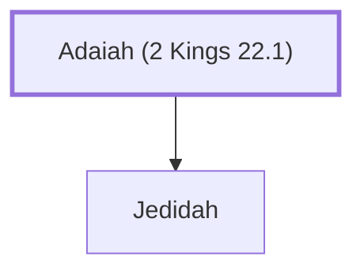

# Adaiah (2 Kings 22.1)

Father of Jedidah who was mother of King Josiah of Judah

**Original-language names:** עֲדָיָ֫הוּ (H5718)

## When

- **Placed around:** [[connections/timeline/7th century BC|641 BC]] *(Ussher: the median date of the passages naming them)*

## Family

- **Children:** [[connections/people/Jedidah|Jedidah]]

**Family group:** [[connections/genealogy/Family of Adam|Family of Adam]], generation 1

## Appears in

[[connections/chapters/12-2-kings/2 Kings 22|2 Kings 22]]

## Appears in the same verse as

[[connections/people/Jedidah|Jedidah]] · [[connections/people/Josiah (1 Kings 13.2)|Josiah (1 Kings 13.2)]] · [[connections/places/Bozkath|Bozkath]] · [[connections/places/Jerusalem|Jerusalem]]
