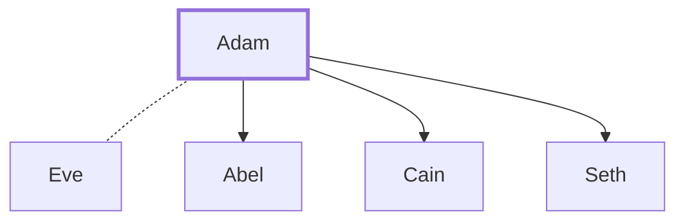

# Adam

The first man, created by God

**Original-language names:** אָדָם (H0121) · הָאָדָם (H0120) · Ἀδάμ (G0076)

## When

- **Lived:** [[connections/timeline/41st century BC|4004 BC]] – [[connections/timeline/31st century BC|3074 BC]] *(Jones)*
- **Placed around:** [[connections/timeline/39th century BC|3874 BC]] *(Ussher: the median date of the passages naming them)*

## Family

- **Brothers and sisters:** [[connections/people/Eve|Eve]]
- **Spouses:** [[connections/people/Eve|Eve]]
- **Children:** [[connections/people/Abel|Abel]], [[connections/people/Cain|Cain]], [[connections/people/Seth|Seth]]
- **Tribe or nation:** Early Patriarch

**Family group:** [[connections/genealogy/Family of Adam|Family of Adam]], generation 1

## Events

- [[connections/timeline/41st century BC|4004 BC]] · [[connections/events/Creation of Adam and Eve|Creation of Adam and Eve]]
- [[connections/timeline/41st century BC|4004 BC]] · [[connections/events/The Fall|The Fall]]
- [[connections/timeline/41st century BC|4004 BC]] · [[connections/events/Lifetime of Adam|Lifetime of Adam]]
- [[connections/timeline/39th century BC|3874 BC]] · [[connections/events/Birth of Seth|Birth of Seth]]
- [[connections/timeline/31st century BC|3074 BC]] · [[connections/events/Death of Adam|Death of Adam]]

## Appears in

[[connections/chapters/01-genesis/Genesis 2|Genesis 2 (4)]] · [[connections/chapters/01-genesis/Genesis 3|Genesis 3 (5)]] · [[connections/chapters/01-genesis/Genesis 4|Genesis 4 (2)]] · [[connections/chapters/01-genesis/Genesis 5|Genesis 5 (5)]] · [[connections/chapters/05-deuteronomy/Deuteronomy 32|Deuteronomy 32]] · [[connections/chapters/13-1-chronicles/1 Chronicles 1|1 Chronicles 1]] · [[connections/chapters/18-job/Job 31|Job 31]] · [[connections/chapters/28-hosea/Hosea 6|Hosea 6]] · [[connections/chapters/42-luke/Luke 3|Luke 3]] · [[connections/chapters/45-romans/Romans 5|Romans 5]] · [[connections/chapters/46-1-corinthians/1 Corinthians 15|1 Corinthians 15 (2)]] · [[connections/chapters/54-1-timothy/1 Timothy 2|1 Timothy 2 (2)]] · [[connections/chapters/65-jude/Jude 1|Jude 1]]

## Appears in the same verse as

[[connections/people/Seth|Seth (5)]] · [[connections/people/Eve|Eve (3)]] · [[connections/people/Cain|Cain (2)]] · [[connections/people/Enosh|Enosh (2)]] · [[connections/people/Abel|Abel]] · [[connections/people/Enoch (Genesis 5.18)|Enoch (Genesis 5.18)]] · [[connections/people/Israel|Israel]] · [[connections/people/Jesus|Jesus]] · [[connections/people/Moses|Moses]]
