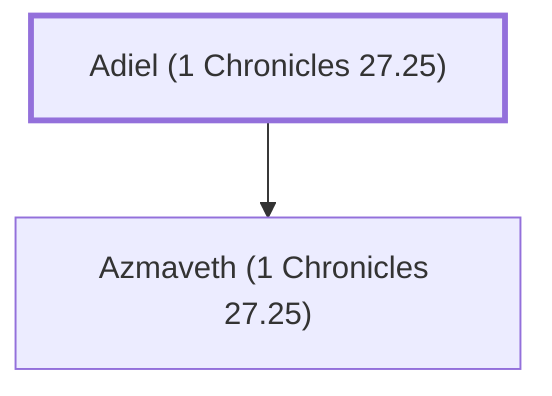

# Adiel (1 Chronicles 27.25)

Overseer of King David's treasuries

**Original-language names:** עֲדִיאֵל (H5717)

## When

- **Placed around:** [[connections/timeline/11th century BC|1015 BC]] *(Ussher: the median date of the passages naming them)*

## Family

- **Children:** [[connections/people/Azmaveth (1 Chronicles 27.25)|Azmaveth (1 Chronicles 27.25)]]

**Family group:** [[connections/genealogy/Family of Adiel (1 Chronicles 27.25)|Family of Adiel (1 Chronicles 27.25)]], generation 1

## Appears in

[[connections/chapters/13-1-chronicles/1 Chronicles 27|1 Chronicles 27]]

## Appears in the same verse as

[[connections/people/Azmaveth (1 Chronicles 27.25)|Azmaveth (1 Chronicles 27.25)]] · [[connections/people/Jonathan (1 Chronicles 27.25)|Jonathan (1 Chronicles 27.25)]] · [[connections/people/Uzziah (1 Chronicles 27.25)|Uzziah (1 Chronicles 27.25)]]
