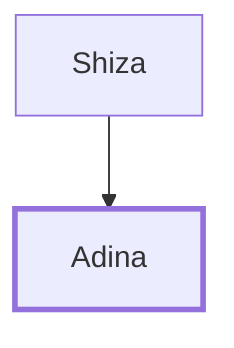

# Adina

One of David's mighty men, a Reubenite leader

**Original-language names:** עֲדִינָא (H5721)

## When

- **Placed around:** [[connections/timeline/11th century BC|1055 BC]] *(Ussher: the median date of the passages naming them)*

## Family

- **Father:** [[connections/people/Shiza|Shiza]]

**Family group:** [[connections/genealogy/Family of Shiza|Family of Shiza]], generation 2

## Appears in

[[connections/chapters/13-1-chronicles/1 Chronicles 11|1 Chronicles 11]]

## Appears in the same verse as

[[connections/people/Shiza|Shiza]]
