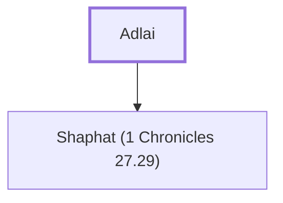

# Adlai

Overseer of King David's herds in the valleys

**Original-language names:** עַדְלָ֑י (H5724)

## When

- **Placed around:** [[connections/timeline/11th century BC|1015 BC]] *(Ussher: the median date of the passages naming them)*

## Family

- **Children:** [[connections/people/Shaphat (1 Chronicles 27.29)|Shaphat (1 Chronicles 27.29)]]

**Family group:** [[connections/genealogy/Family of Adlai|Family of Adlai]], generation 1

## Appears in

[[connections/chapters/13-1-chronicles/1 Chronicles 27|1 Chronicles 27]]

## Appears in the same verse as

[[connections/people/Shaphat (1 Chronicles 27.29)|Shaphat (1 Chronicles 27.29)]] · [[connections/people/Shitrai|Shitrai]] · [[connections/places/Sharon (1 Chronicles 27.29)|Sharon (1 Chronicles 27.29)]]
