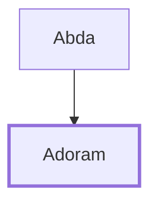

# Adoram

Official in charge of forced labor under David and Solomon

**Also called:** Adoniram, Hadoram

**Original-language names:** אֲדֹרָם (H0151) · אֲדֹנִירָם (H0141) · הֲדֹרָם (H1913b)

## When

- **Placed around:** [[connections/timeline/11th century BC|1014 BC]] *(Ussher: the median date of the passages naming them)*

## Family

- **Father:** [[connections/people/Abda|Abda]]

**Family group:** [[connections/genealogy/Family of Abda|Family of Abda]], generation 2

## Appears in

[[connections/chapters/10-2-samuel/2 Samuel 20|2 Samuel 20]] · [[connections/chapters/11-1-kings/1 Kings 4|1 Kings 4]] · [[connections/chapters/11-1-kings/1 Kings 5|1 Kings 5]] · [[connections/chapters/11-1-kings/1 Kings 12|1 Kings 12]] · [[connections/chapters/14-2-chronicles/2 Chronicles 10|2 Chronicles 10]]

## Appears in the same verse as

[[connections/people/Israel|Israel (2)]] · [[connections/people/Rehoboam|Rehoboam (2)]] · [[connections/places/Jerusalem|Jerusalem (2)]] · [[connections/people/Abda|Abda]] · [[connections/people/Ahilud|Ahilud]] · [[connections/people/Ahishar|Ahishar]] · [[connections/people/Jehoshaphat (2 Samuel 8.16)|Jehoshaphat (2 Samuel 8.16)]] · [[connections/places/Lebanon|Lebanon]]
