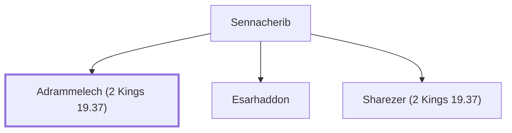

# Adrammelech (2 Kings 19.37)

Son of Sennacherib who murdered his father

**Original-language names:** אַדְרַמֶּ֫לֶךְ (H0152)

## When

- **Placed around:** [[connections/timeline/8th century BC|710 BC]] *(Ussher: the median date of the passages naming them)*

## Family

- **Father:** [[connections/people/Sennacherib|Sennacherib]]
- **Brothers and sisters:** [[connections/people/Esarhaddon|Esarhaddon]], [[connections/people/Sharezer (2 Kings 19.37)|Sharezer (2 Kings 19.37)]]

**Family group:** [[connections/genealogy/Family of Sennacherib|Family of Sennacherib]], generation 2

## Appears in

[[connections/chapters/12-2-kings/2 Kings 19|2 Kings 19]] · [[connections/chapters/23-isaiah/Isaiah 37|Isaiah 37]]

## Appears in the same verse as

[[connections/people/Esarhaddon|Esarhaddon (2)]] · [[connections/people/Sharezer (2 Kings 19.37)|Sharezer (2 Kings 19.37) (2)]] · [[connections/places/Ararat|Ararat (2)]]
