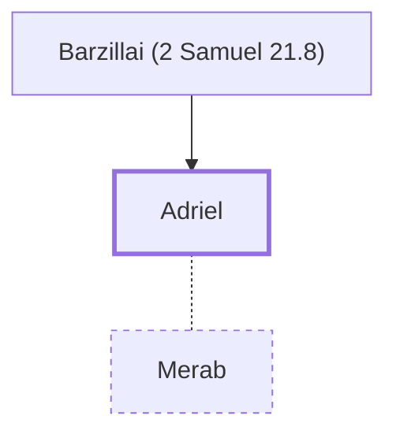

# Adriel

Saul's son-in-law; husband of Merab

**Original-language names:** עַדְרִיאֵל (H5741)

## When

- **Placed around:** [[connections/timeline/11th century BC|1018 BC]] *(Ussher: the median date of the passages naming them)*

## Family

- **Father:** [[connections/people/Barzillai (2 Samuel 21.8)|Barzillai (2 Samuel 21.8)]]
- **Spouses:** [[connections/people/Merab|Merab]]

**Family group:** [[connections/genealogy/Family of Barzillai (2 Samuel 21.8)|Family of Barzillai (2 Samuel 21.8)]], generation 2

## Appears in

[[connections/chapters/09-1-samuel/1 Samuel 18|1 Samuel 18]] · [[connections/chapters/10-2-samuel/2 Samuel 21|2 Samuel 21]]

## Appears in the same verse as

[[connections/people/Merab|Merab (2)]] · [[connections/people/Saul|Saul (2)]] · [[connections/people/Aiah (2 Samuel 3.7)|Aiah (2 Samuel 3.7)]] · [[connections/people/Armoni|Armoni]] · [[connections/people/Barzillai (2 Samuel 21.8)|Barzillai (2 Samuel 21.8)]] · [[connections/people/David|David]] · [[connections/people/Mephibosheth (2 Samuel 21.8)|Mephibosheth (2 Samuel 21.8)]] · [[connections/people/Rizpah|Rizpah]]
