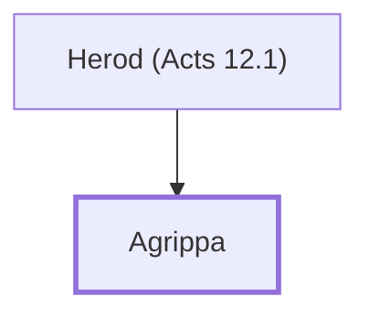

# Agrippa

Tetrarch who heard Paul's defense in Caesarea

**Original-language names:** Ἀγρίππας (G0067)

## When

- **Placed around:** [[connections/timeline/1st century AD|AD 62]] *(Ussher: the median date of the passages naming them)*
- **Reigned / in office:** c. [[connections/timeline/1st century AD|AD 48]] – [[connections/timeline/1st century AD|AD 93]] *(modern dates)* · Herod Agrippa II, Herodian · [Wikidata Q313419](https://www.wikidata.org/wiki/Q313419)

## Family

- **Father:** [[connections/people/Herod (Acts 12.1)|Herod (Acts 12.1)]]
- **Tribe or nation:** Italy

**Family group:** [[connections/genealogy/Family of Herod (Acts 12.1)|Family of Herod (Acts 12.1)]], generation 2

## Events

- [[connections/timeline/1st century AD|AD 56]] · [[connections/events/Agrippa and Bernice meet Festus|Agrippa and Bernice meet Festus]]
- [[connections/timeline/1st century AD|AD 56]] · [[connections/events/Paul goes before Agrippa|Paul goes before Agrippa]]

## Appears in

[[connections/chapters/44-acts/Acts 25|Acts 25 (5)]] · [[connections/chapters/44-acts/Acts 26|Acts 26 (7)]]

## Appears in the same verse as

[[connections/people/Festus|Festus (5)]] · [[connections/people/Paul|Paul (3)]] · [[connections/people/Bernice|Bernice (2)]] · [[connections/people/Claudius|Claudius]] · [[connections/places/Caesarea|Caesarea]] · [[connections/places/Jerusalem|Jerusalem]]
