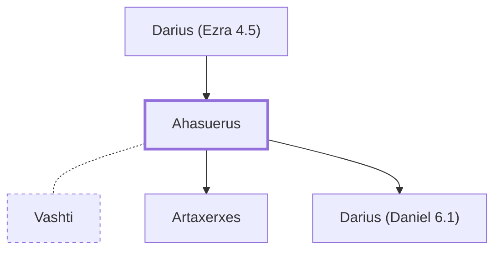

# Ahasuerus

Persian Emperor (probably Xerxes I); husband of Esther

**Original-language names:** אֲחַשְׁוֵרוֹשׁ (H0325)

## When

- **Placed around:** [[connections/timeline/5th century BC|453 BC]] *(Ussher: the median date of the passages naming them)*
- **Reigned / in office:** [[connections/timeline/5th century BC|486 BC]] – [[connections/timeline/5th century BC|465 BC]] *(modern dates)* · Xerxes I, Persia · [Wikidata Q129165](https://www.wikidata.org/wiki/Q129165) · Ahasuerus of Esther is usually identified with Xerxes I

## Family

- **Father:** [[connections/people/Darius (Ezra 4.5)|Darius (Ezra 4.5)]]
- **Spouses:** [[connections/people/Vashti|Vashti]]
- **Children:** [[connections/people/Artaxerxes|Artaxerxes]], [[connections/people/Darius (Daniel 6.1)|Darius (Daniel 6.1)]]
- **Tribe or nation:** Persia

**Family group:** [[connections/genealogy/Family of Darius (Ezra 4.5)|Family of Darius (Ezra 4.5)]], generation 2

## Appears in

[[connections/chapters/15-ezra/Ezra 4|Ezra 4]] · [[connections/chapters/17-esther/Esther 1|Esther 1 (8)]] · [[connections/chapters/17-esther/Esther 2|Esther 2 (4)]] · [[connections/chapters/17-esther/Esther 3|Esther 3 (5)]] · [[connections/chapters/17-esther/Esther 6|Esther 6]] · [[connections/chapters/17-esther/Esther 7|Esther 7]] · [[connections/chapters/17-esther/Esther 8|Esther 8 (4)]] · [[connections/chapters/17-esther/Esther 9|Esther 9 (3)]] · [[connections/chapters/17-esther/Esther 10|Esther 10 (2)]] · [[connections/chapters/27-daniel/Daniel 9|Daniel 9]]

## Appears in the same verse as

[[connections/people/Haman|Haman (7)]] · [[connections/people/Mordecai (Esther 2.5)|Mordecai (Esther 2.5) (7)]] · [[connections/people/Vashti|Vashti (6)]] · [[connections/people/Esther|Esther (4)]] · [[connections/people/Bigthan|Bigthan (2)]] · [[connections/people/Teresh|Teresh (2)]] · [[connections/people/Abagtha|Abagtha]] · [[connections/people/Bigtha|Bigtha]] · [[connections/people/Biztha|Biztha]] · [[connections/people/Carkas|Carkas]] · [[connections/people/Darius (Daniel 6.1)|Darius (Daniel 6.1)]] · [[connections/people/Hammedatha|Hammedatha]] · [[connections/people/Harbona|Harbona]] · [[connections/people/Judah (Genesis 29.35)|Judah (Genesis 29.35)]] · [[connections/people/Mehuman|Mehuman]] · [[connections/people/Memucan|Memucan]] · [[connections/people/Zethar|Zethar]] · [[connections/places/Chaldea|Chaldea]] · [[connections/places/Cush|Cush]] · [[connections/places/India|India]] · [[connections/places/Jerusalem|Jerusalem]] · [[connections/places/Persia|Persia]] · [[connections/places/Susa|Susa]]
