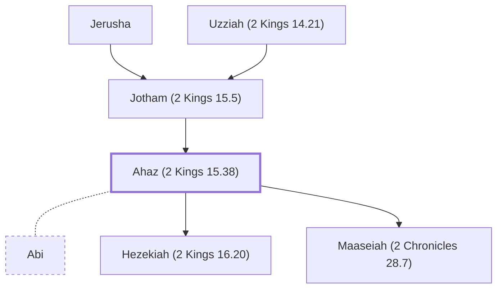

# Ahaz (2 Kings 15.38)

King of Judah, son of Jotham

**Original-language names:** אָחָז (H0271) · Ἀχάζ (G0881)

## When

- **Lived:** [[connections/timeline/8th century BC|763 BC]] – [[connections/timeline/8th century BC|726 BC]] *(Jones)*
- **Placed around:** [[connections/timeline/8th century BC|740 BC]] *(Ussher: the median date of the passages naming them)*

## Family

- **Father:** [[connections/people/Jotham (2 Kings 15.5)|Jotham (2 Kings 15.5)]]
- **Spouses:** [[connections/people/Abi|Abi]]
- **Children:** [[connections/people/Hezekiah (2 Kings 16.20)|Hezekiah (2 Kings 16.20)]], [[connections/people/Maaseiah (2 Chronicles 28.7)|Maaseiah (2 Chronicles 28.7)]]
- **Tribe or nation:** Tribe of Judah

**Line of descent** (46 generations, father to son): [[connections/people/Adam|Adam]] → [[connections/people/Seth|Seth]] → [[connections/people/Enosh|Enosh]] → [[connections/people/Kenan|Kenan]] → [[connections/people/Mahalalel (Genesis 5.12)|Mahalalel (Genesis 5.12)]] → [[connections/people/Jared|Jared]] → [[connections/people/Enoch (Genesis 5.18)|Enoch (Genesis 5.18)]] → [[connections/people/Methuselah|Methuselah]] → [[connections/people/Lamech (Genesis 5.25)|Lamech (Genesis 5.25)]] → [[connections/people/Noah (Genesis 5.29)|Noah (Genesis 5.29)]] → [[connections/people/Shem|Shem]] → [[connections/people/Arpachshad|Arpachshad]] → [[connections/people/Cainan|Cainan]] → [[connections/people/Shelah (Genesis 10.24)|Shelah (Genesis 10.24)]] → [[connections/people/Eber (Genesis 10.21)|Eber (Genesis 10.21)]] → [[connections/people/Peleg|Peleg]] → [[connections/people/Reu|Reu]] → [[connections/people/Serug|Serug]] → [[connections/people/Nahor (Genesis 11.22)|Nahor (Genesis 11.22)]] → [[connections/people/Terah|Terah]] → [[connections/people/Abraham|Abraham]] → [[connections/people/Isaac|Isaac]] → [[connections/people/Israel|Israel]] → [[connections/people/Judah (Genesis 29.35)|Judah (Genesis 29.35)]] → [[connections/people/Perez|Perez]] → [[connections/people/Hezron (Genesis 46.12)|Hezron (Genesis 46.12)]] → [[connections/people/Ram (Ruth 4.19)|Ram (Ruth 4.19)]] → [[connections/people/Amminadab (Exodus 6.23)|Amminadab (Exodus 6.23)]] → [[connections/people/Nahshon|Nahshon]] → [[connections/people/Salmon|Salmon]] → [[connections/people/Boaz|Boaz]] → [[connections/people/Obed (Ruth 4.17)|Obed (Ruth 4.17)]] → [[connections/people/Jesse|Jesse]] → [[connections/people/David|David]] → [[connections/people/Solomon|Solomon]] → [[connections/people/Rehoboam|Rehoboam]] → [[connections/people/Abijah (1 Kings 14.31)|Abijah (1 Kings 14.31)]] → [[connections/people/Asa (1 Kings 15.8)|Asa (1 Kings 15.8)]] → [[connections/people/Jehoshaphat (1 Kings 15.24)|Jehoshaphat (1 Kings 15.24)]] → [[connections/people/Jehoram (1 Kings 22.51)|Jehoram (1 Kings 22.51)]] → [[connections/people/Ahaziah (2 Kings 8.24)|Ahaziah (2 Kings 8.24)]] → [[connections/people/Joash (2 Kings 11.2)|Joash (2 Kings 11.2)]] → [[connections/people/Amaziah (2 Kings 12.22)|Amaziah (2 Kings 12.22)]] → [[connections/people/Uzziah (2 Kings 14.21)|Uzziah (2 Kings 14.21)]] → [[connections/people/Jotham (2 Kings 15.5)|Jotham (2 Kings 15.5)]] → **Ahaz (2 Kings 15.38)**

**Family group:** [[connections/genealogy/Family of Adam|Family of Adam]], generation 46

## Events

- [[connections/timeline/8th century BC|742 BC]] · [[connections/events/Reign of Ahaz|Reign of Ahaz]]
- [[connections/timeline/8th century BC|726 BC]] · [[connections/events/Death of Ahaz|Death of Ahaz]]

## Appears in

[[connections/chapters/12-2-kings/2 Kings 15|2 Kings 15]] · [[connections/chapters/12-2-kings/2 Kings 16|2 Kings 16 (12)]] · [[connections/chapters/12-2-kings/2 Kings 17|2 Kings 17]] · [[connections/chapters/12-2-kings/2 Kings 18|2 Kings 18]] · [[connections/chapters/12-2-kings/2 Kings 20|2 Kings 20]] · [[connections/chapters/12-2-kings/2 Kings 23|2 Kings 23]] · [[connections/chapters/13-1-chronicles/1 Chronicles 3|1 Chronicles 3]] · [[connections/chapters/14-2-chronicles/2 Chronicles 27|2 Chronicles 27]] · [[connections/chapters/14-2-chronicles/2 Chronicles 28|2 Chronicles 28 (7)]] · [[connections/chapters/14-2-chronicles/2 Chronicles 29|2 Chronicles 29]] · [[connections/chapters/23-isaiah/Isaiah 1|Isaiah 1]] · [[connections/chapters/23-isaiah/Isaiah 7|Isaiah 7 (4)]] · [[connections/chapters/23-isaiah/Isaiah 14|Isaiah 14]] · [[connections/chapters/23-isaiah/Isaiah 38|Isaiah 38]] · [[connections/chapters/28-hosea/Hosea 1|Hosea 1]] · [[connections/chapters/33-micah/Micah 1|Micah 1]] · [[connections/chapters/40-matthew/Matthew 1|Matthew 1]]

## Appears in the same verse as

[[connections/people/Judah (Genesis 29.35)|Judah (Genesis 29.35) (10)]] · [[connections/people/Hezekiah (2 Kings 16.20)|Hezekiah (2 Kings 16.20) (8)]] · [[connections/people/Israel|Israel (8)]] · [[connections/people/Jotham (2 Kings 15.5)|Jotham (2 Kings 15.5) (8)]] · [[connections/places/Jerusalem|Jerusalem (8)]] · [[connections/people/David|David (5)]] · [[connections/places/Assyria|Assyria (5)]] · [[connections/people/Uriah (2 Kings 16.10)|Uriah (2 Kings 16.10) (4)]] · [[connections/people/Uzziah (2 Kings 14.21)|Uzziah (2 Kings 14.21) (4)]] · [[connections/people/Isaiah|Isaiah (3)]] · [[connections/people/Pekah|Pekah (3)]] · [[connections/people/Remaliah|Remaliah (3)]] · [[connections/places/Syria|Syria (3)]] · [[connections/people/Elah (2 Kings 15.30)|Elah (2 Kings 15.30) (2)]] · [[connections/people/Hoshea (2 Kings 15.30)|Hoshea (2 Kings 15.30) (2)]] · [[connections/people/Manasseh (2 Kings 20.21)|Manasseh (2 Kings 20.21) (2)]] · [[connections/people/Rezin (2 Kings 15.37)|Rezin (2 Kings 15.37) (2)]] · [[connections/people/Tiglath-pileser|Tiglath-pileser (2)]] · [[connections/places/Damascus|Damascus (2)]] · [[connections/places/Samaria|Samaria (2)]] · [[connections/people/Amoz|Amoz]] · [[connections/people/Beeri (Hosea 1.1)|Beeri (Hosea 1.1)]] · [[connections/people/Hosea|Hosea]] · [[connections/people/Jeroboam (2 Kings 13.13)|Jeroboam (2 Kings 13.13)]] · [[connections/people/Joash (2 Kings 13.9)|Joash (2 Kings 13.9)]] · [[connections/people/Micah (Jeremiah 26.18)|Micah (Jeremiah 26.18)]] · [[connections/people/Shear-jashub|Shear-jashub]] · [[connections/places/Kidron|Kidron]] · [[connections/places/Washer's Field|Washer's Field]]
