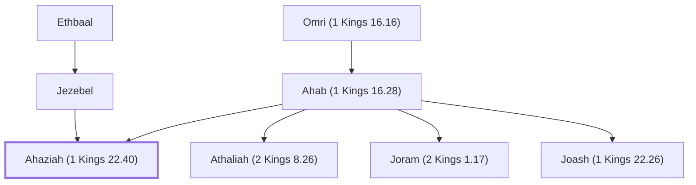

# Ahaziah (1 Kings 22.40)

King of Israel, son of Ahab

**Original-language names:** אֲחַזְיָ֫הוּ (H0274)

## When

- **Placed around:** [[connections/timeline/9th century BC|896 BC]] *(Ussher: the median date of the passages naming them)*

## Family

- **Father:** [[connections/people/Ahab (1 Kings 16.28)|Ahab (1 Kings 16.28)]]
- **Mother:** [[connections/people/Jezebel|Jezebel]]
- **Brothers and sisters:** [[connections/people/Athaliah (2 Kings 8.26)|Athaliah (2 Kings 8.26)]], [[connections/people/Joram (2 Kings 1.17)|Joram (2 Kings 1.17)]], [[connections/people/Joash (1 Kings 22.26)|Joash (1 Kings 22.26)]]
- **Tribe or nation:** Israel

**Line of descent** (3 generations, father to son): [[connections/people/Omri (1 Kings 16.16)|Omri (1 Kings 16.16)]] → [[connections/people/Ahab (1 Kings 16.28)|Ahab (1 Kings 16.28)]] → **Ahaziah (1 Kings 22.40)**

**Family group:** [[connections/genealogy/Family of Adam|Family of Adam]], generation 3

## Events

- [[connections/timeline/9th century BC|897 BC]] · [[connections/events/Reign of Ahaziah|Reign of Ahaziah]]

## Appears in

[[connections/chapters/11-1-kings/1 Kings 22|1 Kings 22 (3)]] · [[connections/chapters/12-2-kings/2 Kings 1|2 Kings 1 (2)]] · [[connections/chapters/14-2-chronicles/2 Chronicles 20|2 Chronicles 20 (2)]]

## Appears in the same verse as

[[connections/people/Jehoshaphat (1 Kings 15.24)|Jehoshaphat (1 Kings 15.24) (4)]] · [[connections/people/Ahab (1 Kings 16.28)|Ahab (1 Kings 16.28) (3)]] · [[connections/people/Israel|Israel (3)]] · [[connections/people/Judah (Genesis 29.35)|Judah (Genesis 29.35) (2)]] · [[connections/places/Samaria|Samaria (2)]] · [[connections/people/Baal-zebub|Baal-zebub]] · [[connections/people/Dodavahu|Dodavahu]] · [[connections/people/Eliezer (2 Chronicles 20.37)|Eliezer (2 Chronicles 20.37)]] · [[connections/places/Ekron|Ekron]] · [[connections/places/Mareshah|Mareshah]] · [[connections/places/Tarshish|Tarshish]]
