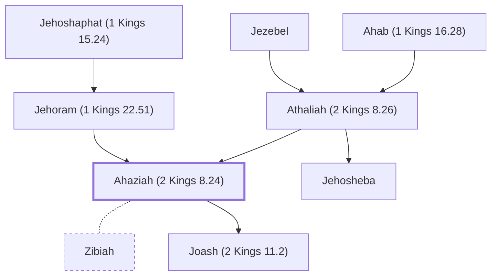

# Ahaziah (2 Kings 8.24)

King of Judah, son of Jehoram and Athaliah

**Also called:** Azariah, Jehoahaz

**Original-language names:** אֲחַזְיָ֫הוּ (H0274) · עֲזַרְיָ֫הוּ (H5838) · יְהוֹאָחָז (H3059)

## When

- **Lived:** [[connections/timeline/10th century BC|908 BC]] – [[connections/timeline/9th century BC|886 BC]] *(Jones)*
- **Placed around:** [[connections/timeline/9th century BC|885 BC]] *(Ussher: the median date of the passages naming them)*

## Family

- **Father:** [[connections/people/Jehoram (1 Kings 22.51)|Jehoram (1 Kings 22.51)]]
- **Mother:** [[connections/people/Athaliah (2 Kings 8.26)|Athaliah (2 Kings 8.26)]]
- **Brothers and sisters:** [[connections/people/Jehosheba|Jehosheba]]
- **Spouses:** [[connections/people/Zibiah|Zibiah]]
- **Children:** [[connections/people/Joash (2 Kings 11.2)|Joash (2 Kings 11.2)]]
- **Tribe or nation:** Tribe of Judah

**Line of descent** (41 generations, father to son): [[connections/people/Adam|Adam]] → [[connections/people/Seth|Seth]] → [[connections/people/Enosh|Enosh]] → [[connections/people/Kenan|Kenan]] → [[connections/people/Mahalalel (Genesis 5.12)|Mahalalel (Genesis 5.12)]] → [[connections/people/Jared|Jared]] → [[connections/people/Enoch (Genesis 5.18)|Enoch (Genesis 5.18)]] → [[connections/people/Methuselah|Methuselah]] → [[connections/people/Lamech (Genesis 5.25)|Lamech (Genesis 5.25)]] → [[connections/people/Noah (Genesis 5.29)|Noah (Genesis 5.29)]] → [[connections/people/Shem|Shem]] → [[connections/people/Arpachshad|Arpachshad]] → [[connections/people/Cainan|Cainan]] → [[connections/people/Shelah (Genesis 10.24)|Shelah (Genesis 10.24)]] → [[connections/people/Eber (Genesis 10.21)|Eber (Genesis 10.21)]] → [[connections/people/Peleg|Peleg]] → [[connections/people/Reu|Reu]] → [[connections/people/Serug|Serug]] → [[connections/people/Nahor (Genesis 11.22)|Nahor (Genesis 11.22)]] → [[connections/people/Terah|Terah]] → [[connections/people/Abraham|Abraham]] → [[connections/people/Isaac|Isaac]] → [[connections/people/Israel|Israel]] → [[connections/people/Judah (Genesis 29.35)|Judah (Genesis 29.35)]] → [[connections/people/Perez|Perez]] → [[connections/people/Hezron (Genesis 46.12)|Hezron (Genesis 46.12)]] → [[connections/people/Ram (Ruth 4.19)|Ram (Ruth 4.19)]] → [[connections/people/Amminadab (Exodus 6.23)|Amminadab (Exodus 6.23)]] → [[connections/people/Nahshon|Nahshon]] → [[connections/people/Salmon|Salmon]] → [[connections/people/Boaz|Boaz]] → [[connections/people/Obed (Ruth 4.17)|Obed (Ruth 4.17)]] → [[connections/people/Jesse|Jesse]] → [[connections/people/David|David]] → [[connections/people/Solomon|Solomon]] → [[connections/people/Rehoboam|Rehoboam]] → [[connections/people/Abijah (1 Kings 14.31)|Abijah (1 Kings 14.31)]] → [[connections/people/Asa (1 Kings 15.8)|Asa (1 Kings 15.8)]] → [[connections/people/Jehoshaphat (1 Kings 15.24)|Jehoshaphat (1 Kings 15.24)]] → [[connections/people/Jehoram (1 Kings 22.51)|Jehoram (1 Kings 22.51)]] → **Ahaziah (2 Kings 8.24)**

**Family group:** [[connections/genealogy/Family of Adam|Family of Adam]], generation 41

## Events

- [[connections/timeline/9th century BC|886 BC]] · [[connections/events/Reign of Ahaziah (Jehoahaz)|Reign of Ahaziah (Jehoahaz)]]

## Appears in

[[connections/chapters/12-2-kings/2 Kings 8|2 Kings 8 (4)]] · [[connections/chapters/12-2-kings/2 Kings 9|2 Kings 9 (5)]] · [[connections/chapters/12-2-kings/2 Kings 10|2 Kings 10]] · [[connections/chapters/12-2-kings/2 Kings 11|2 Kings 11 (2)]] · [[connections/chapters/12-2-kings/2 Kings 12|2 Kings 12]] · [[connections/chapters/12-2-kings/2 Kings 13|2 Kings 13]] · [[connections/chapters/12-2-kings/2 Kings 14|2 Kings 14]] · [[connections/chapters/13-1-chronicles/1 Chronicles 3|1 Chronicles 3]] · [[connections/chapters/14-2-chronicles/2 Chronicles 21|2 Chronicles 21]] · [[connections/chapters/14-2-chronicles/2 Chronicles 22|2 Chronicles 22 (8)]] · [[connections/chapters/14-2-chronicles/2 Chronicles 25|2 Chronicles 25]]

## Appears in the same verse as

[[connections/people/Judah (Genesis 29.35)|Judah (Genesis 29.35) (16)]] · [[connections/people/Jehoram (1 Kings 22.51)|Jehoram (1 Kings 22.51) (9)]] · [[connections/people/Jehu (1 Kings 19.16)|Jehu (1 Kings 19.16) (8)]] · [[connections/people/Joram (2 Kings 1.17)|Joram (2 Kings 1.17) (8)]] · [[connections/people/Joash (2 Kings 11.2)|Joash (2 Kings 11.2) (7)]] · [[connections/people/Ahab (1 Kings 16.28)|Ahab (1 Kings 16.28) (6)]] · [[connections/people/Athaliah (2 Kings 8.26)|Athaliah (2 Kings 8.26) (6)]] · [[connections/people/Israel|Israel (6)]] · [[connections/places/Jerusalem|Jerusalem (6)]] · [[connections/people/Hazael|Hazael (3)]] · [[connections/places/Jezreel (Joshua 19.18)|Jezreel (Joshua 19.18) (3)]] · [[connections/places/Syria|Syria (3)]] · [[connections/people/Amaziah (2 Kings 12.22)|Amaziah (2 Kings 12.22) (2)]] · [[connections/people/Jehoshaphat (1 Kings 15.24)|Jehoshaphat (1 Kings 15.24) (2)]] · [[connections/people/Jehosheba|Jehosheba (2)]] · [[connections/people/Joash (2 Kings 13.9)|Joash (2 Kings 13.9) (2)]] · [[connections/people/Omri (1 Kings 16.16)|Omri (1 Kings 16.16) (2)]] · [[connections/places/Beth-shemesh (Joshua 15.10)|Beth-shemesh (Joshua 15.10) (2)]] · [[connections/places/Corner Gate|Corner Gate (2)]] · [[connections/places/Ephraim Gate|Ephraim Gate (2)]] · [[connections/places/Ramoth|Ramoth (2)]] · [[connections/places/Samaria|Samaria (2)]] · [[connections/people/David|David]] · [[connections/people/Jehoahaz (2 Kings 10.35)|Jehoahaz (2 Kings 10.35)]] · [[connections/people/Jehoiada (2 Kings 11.4)|Jehoiada (2 Kings 11.4)]] · [[connections/people/Naboth|Naboth]] · [[connections/people/Nimshi|Nimshi]] · [[connections/places/Beth-haggan|Beth-haggan]] · [[connections/places/Gur|Gur]] · [[connections/places/Ibleam|Ibleam]] · [[connections/places/Megiddo|Megiddo]]
