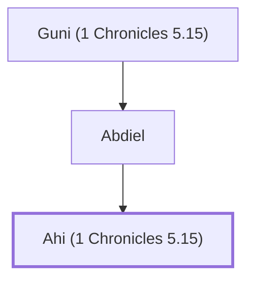

# Ahi (1 Chronicles 5.15)

Son of Abdiel, a Gadite chief

**Original-language names:** אֲחִי (H0277)

## When

- **Placed around:** [[connections/timeline/11th century BC|1060 BC]] *(Ussher: the median date of the passages naming them)*

## Family

- **Father:** [[connections/people/Abdiel|Abdiel]]
- **Tribe or nation:** Tribe of Gad

**Line of descent** (3 generations, father to son): [[connections/people/Guni (1 Chronicles 5.15)|Guni (1 Chronicles 5.15)]] → [[connections/people/Abdiel|Abdiel]] → **Ahi (1 Chronicles 5.15)**

**Family group:** [[connections/genealogy/Family of Guni (1 Chronicles 5.15)|Family of Guni (1 Chronicles 5.15)]], generation 3

## Appears in

[[connections/chapters/13-1-chronicles/1 Chronicles 5|1 Chronicles 5]]

## Appears in the same verse as

[[connections/people/Abdiel|Abdiel]] · [[connections/people/Guni (1 Chronicles 5.15)|Guni (1 Chronicles 5.15)]]
