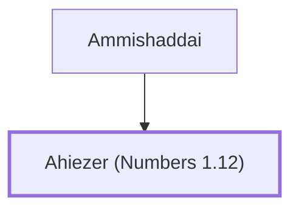

# Ahiezer (Numbers 1.12)

Leader from the tribe of Dan during the Exodus

**Original-language names:** אֲחִיעֶ֫זֶר (H0295)

## When

- **Placed around:** [[connections/timeline/15th century BC|1490 BC]] *(Ussher: the median date of the passages naming them)*

## Family

- **Father:** [[connections/people/Ammishaddai|Ammishaddai]]
- **Tribe or nation:** Tribe of Dan

**Family group:** [[connections/genealogy/Family of Ammishaddai|Family of Ammishaddai]], generation 2

## Appears in

[[connections/chapters/04-numbers/Numbers 1|Numbers 1]] · [[connections/chapters/04-numbers/Numbers 2|Numbers 2]] · [[connections/chapters/04-numbers/Numbers 7|Numbers 7 (2)]] · [[connections/chapters/04-numbers/Numbers 10|Numbers 10]]

## Appears in the same verse as

[[connections/people/Ammishaddai|Ammishaddai (5)]] · [[connections/places/Dan|Dan (4)]]
