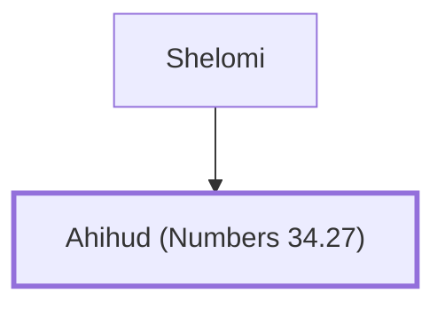

# Ahihud (Numbers 34.27)

Leader from the tribe of Asher for land allocation

**Original-language names:** אֲחִיהוּד (H0282)

## When

- **Placed around:** [[connections/timeline/15th century BC|1452 BC]] *(Ussher: the median date of the passages naming them)*

## Family

- **Father:** [[connections/people/Shelomi|Shelomi]]

**Family group:** [[connections/genealogy/Family of Shelomi|Family of Shelomi]], generation 2

## Appears in

[[connections/chapters/04-numbers/Numbers 34|Numbers 34]]

## Appears in the same verse as

[[connections/people/Asher|Asher]] · [[connections/people/Shelomi|Shelomi]]
