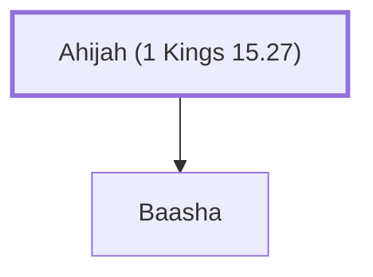

# Ahijah (1 Kings 15.27)

Father of Baasha, king of Israel

**Original-language names:** אֲחִיָּ֫הוּ (H0281)

## When

- **Placed around:** [[connections/timeline/9th century BC|899 BC]] *(Ussher: the median date of the passages naming them)*

## Family

- **Children:** [[connections/people/Baasha|Baasha]]
- **Tribe or nation:** Israel

**Family group:** [[connections/genealogy/Family of Ahijah (1 Kings 15.27)|Family of Ahijah (1 Kings 15.27)]], generation 1

## Appears in

[[connections/chapters/11-1-kings/1 Kings 15|1 Kings 15 (2)]] · [[connections/chapters/11-1-kings/1 Kings 21|1 Kings 21]] · [[connections/chapters/12-2-kings/2 Kings 9|2 Kings 9]]

## Appears in the same verse as

[[connections/people/Baasha|Baasha (4)]] · [[connections/people/Israel|Israel (3)]] · [[connections/people/Jeroboam (1 Kings 11.26)|Jeroboam (1 Kings 11.26) (2)]] · [[connections/people/Nebat|Nebat (2)]] · [[connections/people/Ahab (1 Kings 16.28)|Ahab (1 Kings 16.28)]] · [[connections/people/Asa (1 Kings 15.8)|Asa (1 Kings 15.8)]] · [[connections/people/Issachar (Genesis 30.18)|Issachar (Genesis 30.18)]] · [[connections/people/Judah (Genesis 29.35)|Judah (Genesis 29.35)]] · [[connections/people/Nadab (1 Kings 14.20)|Nadab (1 Kings 14.20)]] · [[connections/places/Gibbethon|Gibbethon]] · [[connections/places/Tirzah|Tirzah]]
