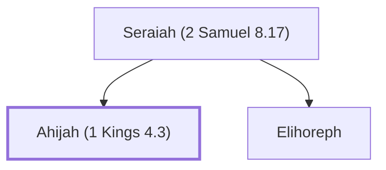

# Ahijah (1 Kings 4.3)

Son of Seraiah (or 'Shisha'), a scribe during Solomon's reign

**Original-language names:** אֲחִיָּ֫הוּ (H0281)

## When

- **Placed around:** [[connections/timeline/11th century BC|1014 BC]] *(Ussher: the median date of the passages naming them)*

## Family

- **Father:** [[connections/people/Seraiah (2 Samuel 8.17)|Seraiah (2 Samuel 8.17)]]
- **Brothers and sisters:** [[connections/people/Elihoreph|Elihoreph]]

**Family group:** [[connections/genealogy/Family of Seraiah (2 Samuel 8.17)|Family of Seraiah (2 Samuel 8.17)]], generation 2

## Appears in

[[connections/chapters/11-1-kings/1 Kings 4|1 Kings 4]]

## Appears in the same verse as

[[connections/people/Ahilud|Ahilud]] · [[connections/people/Elihoreph|Elihoreph]] · [[connections/people/Jehoshaphat (2 Samuel 8.16)|Jehoshaphat (2 Samuel 8.16)]] · [[connections/people/Seraiah (2 Samuel 8.17)|Seraiah (2 Samuel 8.17)]]
