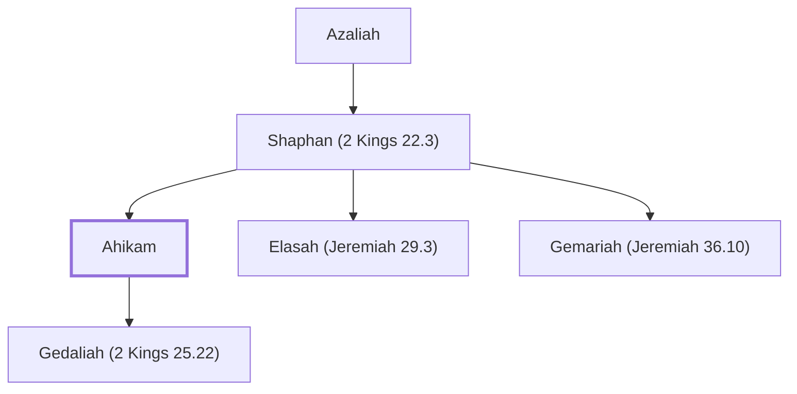

# Ahikam

Son of Shaphan, protected Jeremiah from death

**Original-language names:** אֲחִיקָם (H0296)

## When

- **Placed around:** [[connections/timeline/6th century BC|588 BC]] *(Ussher: the median date of the passages naming them)*

## Family

- **Father:** [[connections/people/Shaphan (2 Kings 22.3)|Shaphan (2 Kings 22.3)]]
- **Brothers and sisters:** [[connections/people/Elasah (Jeremiah 29.3)|Elasah (Jeremiah 29.3)]], [[connections/people/Gemariah (Jeremiah 36.10)|Gemariah (Jeremiah 36.10)]]
- **Children:** [[connections/people/Gedaliah (2 Kings 25.22)|Gedaliah (2 Kings 25.22)]]

**Line of descent** (4 generations, father to son): [[connections/people/Meshullam (2 Kings 22.3)|Meshullam (2 Kings 22.3)]] → [[connections/people/Azaliah|Azaliah]] → [[connections/people/Shaphan (2 Kings 22.3)|Shaphan (2 Kings 22.3)]] → **Ahikam**

**Family group:** [[connections/genealogy/Family of Meshullam (2 Kings 22.3)|Family of Meshullam (2 Kings 22.3)]], generation 4

## Appears in

[[connections/chapters/12-2-kings/2 Kings 22|2 Kings 22 (2)]] · [[connections/chapters/12-2-kings/2 Kings 25|2 Kings 25]] · [[connections/chapters/14-2-chronicles/2 Chronicles 34|2 Chronicles 34]] · [[connections/chapters/24-jeremiah/Jeremiah 26|Jeremiah 26]] · [[connections/chapters/24-jeremiah/Jeremiah 39|Jeremiah 39]] · [[connections/chapters/24-jeremiah/Jeremiah 40|Jeremiah 40 (7)]] · [[connections/chapters/24-jeremiah/Jeremiah 41|Jeremiah 41 (6)]] · [[connections/chapters/24-jeremiah/Jeremiah 43|Jeremiah 43]]

## Appears in the same verse as

[[connections/people/Gedaliah (2 Kings 25.22)|Gedaliah (2 Kings 25.22) (16)]] · [[connections/people/Shaphan (2 Kings 22.3)|Shaphan (2 Kings 22.3) (11)]] · [[connections/people/Ishmael (2 Kings 25.23)|Ishmael (2 Kings 25.23) (8)]] · [[connections/people/Nethaniah (2 Kings 25.23)|Nethaniah (2 Kings 25.23) (7)]] · [[connections/places/Babylon|Babylon (7)]] · [[connections/places/Mizpah|Mizpah (5)]] · [[connections/people/Jeremiah (2 Chronicles 35.25)|Jeremiah (2 Chronicles 35.25) (4)]] · [[connections/people/Achbor (2 Kings 22.12)|Achbor (2 Kings 22.12) (3)]] · [[connections/people/Asaiah (2 Kings 22.12)|Asaiah (2 Kings 22.12) (3)]] · [[connections/people/Hilkiah (2 Kings 22.4)|Hilkiah (2 Kings 22.4) (3)]] · [[connections/people/Judah (Genesis 29.35)|Judah (Genesis 29.35) (3)]] · [[connections/places/Ammon|Ammon (3)]] · [[connections/people/Johanan (2 Kings 25.23)|Johanan (2 Kings 25.23) (2)]] · [[connections/people/Kareah|Kareah (2)]] · [[connections/people/Micaiah (2 Kings 22.12)|Micaiah (2 Kings 22.12) (2)]] · [[connections/people/Nebuzaradan|Nebuzaradan (2)]] · [[connections/places/Chaldea|Chaldea (2)]] · [[connections/people/Baalis|Baalis]] · [[connections/people/Baruch (Jeremiah 32.12)|Baruch (Jeremiah 32.12)]] · [[connections/people/Elishama (2 Kings 25.25)|Elishama (2 Kings 25.25)]] · [[connections/people/Harhas|Harhas]] · [[connections/people/Huldah|Huldah]] · [[connections/people/Nebuchadnezzar|Nebuchadnezzar]] · [[connections/people/Neriah|Neriah]] · [[connections/people/Shallum (2 Kings 22.14)|Shallum (2 Kings 22.14)]] · [[connections/people/Tikvah (2 Kings 22.14)|Tikvah (2 Kings 22.14)]] · [[connections/places/Edom|Edom]] · [[connections/places/Gibeon|Gibeon]] · [[connections/places/Jerusalem|Jerusalem]] · [[connections/places/Moab|Moab]] · [[connections/places/Second Quarter|Second Quarter]]
