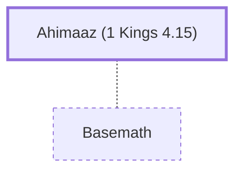

# Ahimaaz (1 Kings 4.15)

Solomon's son-in-law, governor of Naphtali

**Original-language names:** אֲחִימַ֫עַץ (H0290)

## When

- **Placed around:** [[connections/timeline/11th century BC|1014 BC]] *(Ussher: the median date of the passages naming them)*

## Family

- **Spouses:** [[connections/people/Basemath|Basemath]]

## Appears in

[[connections/chapters/11-1-kings/1 Kings 4|1 Kings 4]]

## Appears in the same verse as

[[connections/people/Basemath|Basemath]] · [[connections/people/Naphtali|Naphtali]] · [[connections/people/Solomon|Solomon]]
