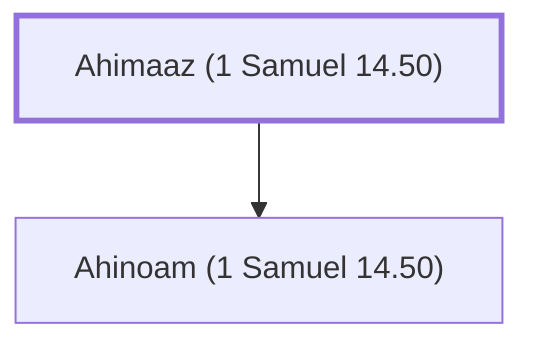

# Ahimaaz (1 Samuel 14.50)

Father of Saul's wife Ahinoam

**Original-language names:** אֲחִימַ֫עַץ (H0290)

## When

- **Placed around:** [[connections/timeline/11th century BC|1087 BC]] *(Ussher: the median date of the passages naming them)*

## Family

- **Children:** [[connections/people/Ahinoam (1 Samuel 14.50)|Ahinoam (1 Samuel 14.50)]]

**Family group:** [[connections/genealogy/Family of Aphiah|Family of Aphiah]], generation 1

## Appears in

[[connections/chapters/09-1-samuel/1 Samuel 14|1 Samuel 14]]

## Appears in the same verse as

[[connections/people/Abner|Abner]] · [[connections/people/Ahinoam (1 Samuel 14.50)|Ahinoam (1 Samuel 14.50)]] · [[connections/people/Ner|Ner]] · [[connections/people/Saul|Saul]]
