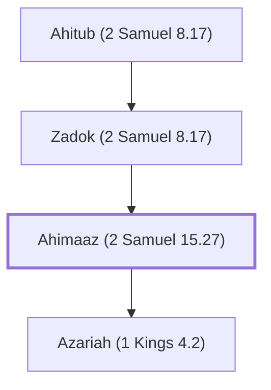

# Ahimaaz (2 Samuel 15.27)

Son of Zadok the priest, a messenger for David

**Original-language names:** אֲחִימַ֫עַץ (H0290)

## When

- **Placed around:** [[connections/timeline/11th century BC|1023 BC]] *(Ussher: the median date of the passages naming them)*

## Family

- **Father:** [[connections/people/Zadok (2 Samuel 8.17)|Zadok (2 Samuel 8.17)]]
- **Children:** [[connections/people/Azariah (1 Kings 4.2)|Azariah (1 Kings 4.2)]]
- **Tribe or nation:** Tribe of Levi

**Line of descent** (38 generations, father to son): [[connections/people/Adam|Adam]] → [[connections/people/Seth|Seth]] → [[connections/people/Enosh|Enosh]] → [[connections/people/Kenan|Kenan]] → [[connections/people/Mahalalel (Genesis 5.12)|Mahalalel (Genesis 5.12)]] → [[connections/people/Jared|Jared]] → [[connections/people/Enoch (Genesis 5.18)|Enoch (Genesis 5.18)]] → [[connections/people/Methuselah|Methuselah]] → [[connections/people/Lamech (Genesis 5.25)|Lamech (Genesis 5.25)]] → [[connections/people/Noah (Genesis 5.29)|Noah (Genesis 5.29)]] → [[connections/people/Shem|Shem]] → [[connections/people/Arpachshad|Arpachshad]] → [[connections/people/Cainan|Cainan]] → [[connections/people/Shelah (Genesis 10.24)|Shelah (Genesis 10.24)]] → [[connections/people/Eber (Genesis 10.21)|Eber (Genesis 10.21)]] → [[connections/people/Peleg|Peleg]] → [[connections/people/Reu|Reu]] → [[connections/people/Serug|Serug]] → [[connections/people/Nahor (Genesis 11.22)|Nahor (Genesis 11.22)]] → [[connections/people/Terah|Terah]] → [[connections/people/Abraham|Abraham]] → [[connections/people/Isaac|Isaac]] → [[connections/people/Israel|Israel]] → [[connections/people/Levi (Genesis 29.34)|Levi (Genesis 29.34)]] → [[connections/people/Kohath|Kohath]] → [[connections/people/Amram (Exodus 6.18)|Amram (Exodus 6.18)]] → [[connections/people/Aaron|Aaron]] → [[connections/people/Eleazar (Exodus 6.23)|Eleazar (Exodus 6.23)]] → [[connections/people/Phinehas (Exodus 6.25)|Phinehas (Exodus 6.25)]] → [[connections/people/Abishua (1 Chronicles 5.30)|Abishua (1 Chronicles 5.30)]] → [[connections/people/Bukki (1 Chronicles 5.31)|Bukki (1 Chronicles 5.31)]] → [[connections/people/Uzzi (1 Chronicles 5.31)|Uzzi (1 Chronicles 5.31)]] → [[connections/people/Zerahiah (1 Chronicles 5.32)|Zerahiah (1 Chronicles 5.32)]] → [[connections/people/Meraioth|Meraioth]] → [[connections/people/Amariah (1 Chronicles 5.33)|Amariah (1 Chronicles 5.33)]] → [[connections/people/Ahitub (2 Samuel 8.17)|Ahitub (2 Samuel 8.17)]] → [[connections/people/Zadok (2 Samuel 8.17)|Zadok (2 Samuel 8.17)]] → **Ahimaaz (2 Samuel 15.27)**

**Family group:** [[connections/genealogy/Family of Adam|Family of Adam]], generation 38

## Appears in

[[connections/chapters/10-2-samuel/2 Samuel 15|2 Samuel 15 (2)]] · [[connections/chapters/10-2-samuel/2 Samuel 17|2 Samuel 17 (2)]] · [[connections/chapters/10-2-samuel/2 Samuel 18|2 Samuel 18 (6)]] · [[connections/chapters/13-1-chronicles/1 Chronicles 5|1 Chronicles 5 (2)]] · [[connections/chapters/13-1-chronicles/1 Chronicles 6|1 Chronicles 6]]

## Appears in the same verse as

[[connections/people/Zadok (2 Samuel 8.17)|Zadok (2 Samuel 8.17) (7)]] · [[connections/people/Jonathan (2 Samuel 15.27)|Jonathan (2 Samuel 15.27) (4)]] · [[connections/people/Abiathar|Abiathar (2)]] · [[connections/people/Absalom|Absalom (2)]] · [[connections/people/Joab (1 Samuel 26.6)|Joab (1 Samuel 26.6) (2)]] · [[connections/people/Ahitub (2 Samuel 8.17)|Ahitub (2 Samuel 8.17)]] · [[connections/people/Azariah (1 Kings 4.2)|Azariah (1 Kings 4.2)]] · [[connections/people/David|David]] · [[connections/people/Johanan (1 Chronicles 5.35)|Johanan (1 Chronicles 5.35)]] · [[connections/places/En-rogel|En-rogel]] · [[connections/places/Jerusalem|Jerusalem]]
